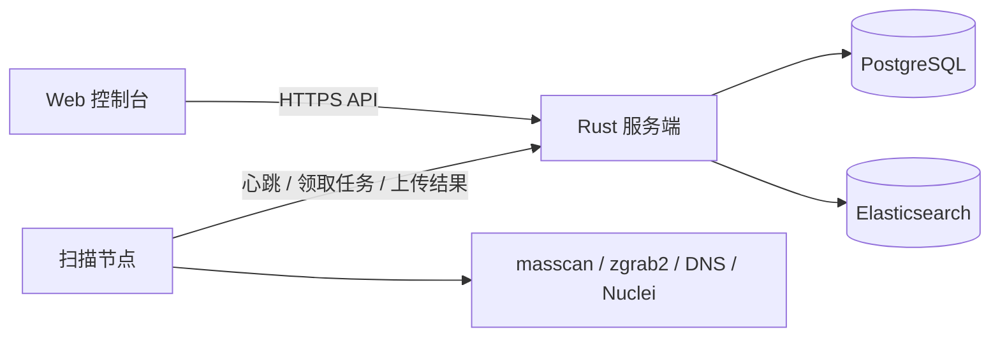

# Network Mapping

**分布式网络测绘与资产管理平台**

基于 Rust 与 Vue 构建，提供 IPv4/IPv6 端口发现、服务识别、DNS 测绘、漏洞扫描与资产搜索。服务端负责调度、数据管理和运维，扫描节点执行任务，Web 控制台提供统一操作界面。

[快速开始](#快速开始) · [部署指南](docs/DEPLOYMENT.md) · [功能指南](docs/FEATURES.md) · [文档中心](docs/README.md)

## 核心能力

| 领域 | 能力 |
| --- | --- |
| 扫描编排 | 多节点调度、独立执行实例、IPv4/IPv6 能力匹配、DNS 后续任务 |
| 资产检索 | 组合表达式、跨端点查询、地理信息、资产标签 |
| 扫描流水线 | 端口发现、服务识别、DNS 解析、Nuclei 漏洞检测 |
| 数据管理 | Elasticsearch 扫描结果存储、PostgreSQL 业务数据与分析快照 |
| 运维治理 | 审计与请求日志、健康告警、扫描器远程诊断、备份、周报/月报 |

## 系统架构



三个组件独立维护、独立版本管理：

| 仓库 | 职责 | 技术 |
| --- | --- | --- |
| **本仓库** | API、调度、数据存储、页面托管与运维 | Rust / Actix Web |
| [Network-Mapping-Scanner](https://github.com/wshijiang/Network-Mapping-Scanner) | 扫描任务执行、结果上传与节点诊断 | Rust / Tokio |
| [network-mapping-vue](https://github.com/wshijiang/network-mapping-vue) | Web 控制台、搜索与资产展示 | Vue / Vite |

## 快速开始

### 1. 准备环境

| 依赖 | 用途 |
| --- | --- |
| Rust / Cargo | 编译服务端；项目使用 edition 2024 |
| PostgreSQL | 用户、权限、任务、配置、上传回执和分析快照 |
| Elasticsearch 9.5.x | 必需的扫描结果存储与搜索服务 |
| TLS 证书与私钥 | 服务端 HTTPS |
| 前端 `dist/` | 登录、控制台、搜索和资产页面 |

### 2. 获取并编译

```sh
git clone https://github.com/wshijiang/network-mapping.git
cd network-mapping
cargo build --locked --release
```

### 3. 配置并启动

编辑 `config.toml` 中的数据库连接、Elasticsearch、TLS、前端目录及 `security.scanner_token_pepper`。详细字段和路径规则见[部署指南](docs/DEPLOYMENT.md)。Pepper 应长期固定，修改后已有扫描器令牌会失效。

```sh
./target/release/network_mapping_server --config config.toml
```

空库首次正常启动会自动创建管理员并在终端显示随机密码；保存凭据，打开配置的 HTTPS 地址登录并改密，再创建和注册扫描器。账号管理见[用户管理 CLI](docs/USER_MANAGEMENT_CLI.md)，完整启动验收见[部署指南](docs/DEPLOYMENT.md#首次启动)。

## 配置与使用

- **启动配置**：连接、证书、密钥和本机路径来自 `config.toml`。
- **运行策略**：数据库已发布值为准；对应 TOML 段仅在记录缺失时初始化。保存接口为 `POST /api/config/runtime/{namespace}`。
- **首次扫描**：确认授权范围和节点能力，再选择“全部”“仅端口”“服务识别”或“仅 DNS”。

首次初始化会沿用 TOML 的扫描启用状态；多实例配置同步存在限制。完整说明见[运行时配置](docs/RUNTIME_CONFIGURATION.md)和[功能指南](docs/FEATURES.md)。

## 开发与验证

从本仓库目录运行：

```sh
cargo fmt --check
cargo clippy --all-targets
cargo test
cargo build --locked --release
```

数据库与服务端集成检查需要有效配置及相应基础设施。修改接口或数据协议时，同步核对扫描器和前端；升级依赖后复核 `source/open_source_projects.json`。

## 文档导航

| 我想了解 | 阅读入口 |
| --- | --- |
| 安装、证书与页面托管 | [部署指南](docs/DEPLOYMENT.md) |
| 搜索、扫描模式与自动任务 | [功能指南](docs/FEATURES.md) |
| API、存储、备份与排障 | [文档中心](docs/README.md) |

## 参与贡献

问题反馈请附组件版本、复现步骤和脱敏日志。提交改动时说明行为变化、配置或 schema 影响及验证结果；界面变更附截图。不要提交真实凭据、运行日志或环境专用配置。

## 许可证

本项目采用 [MIT License](LICENSE)。第三方依赖遵循各自许可证。

## Docker 构建与部署

支持 AMD64/ARM64 镜像自动构建，分支与 PR 验证不发布，正式版本经具体授权后推送 GHCR。
镜像内容、配置、持久化、GitHub 设置及验收见 [Docker 部署指南](docs/DOCKER.md)。
