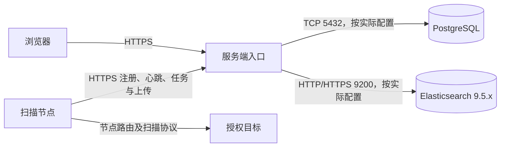

# 服务端部署指南

启动时会检查实际读取的配置字段，并在终端、日志和管理员系统设置中提示缺省参数；自定义 `--config` 路径保持支持，详见 [启动配置检查](CONFIG_CHECK.md)。

[项目首页](../README.md) · [文档中心](README.md)

本文是服务端部署入口，面向 Linux，覆盖部署选型、安装顺序、原生服务托管和升级。容器的具体命令见 [Docker 部署指南](DOCKER.md)；扫描节点见[扫描端部署指南](https://github.com/wshijiang/Network-Mapping-Scanner/blob/main/docs/DEPLOYMENT.md)。已有 PG 扫描结果的升级必须先阅读[Elasticsearch 存储与迁移](ELASTICSEARCH.md)，不能按空库流程直接切换。
Docker 环境变量的全部字段、默认值及 Compose 设置见 [完整配置参考](DOCKER_CONFIGURATION.md)。

[部署方式与安装顺序](#部署方式与安装顺序) · [准备环境](#准备环境) · [文件布局](#文件布局) · [数据库](#数据库) · [配置](#配置) · [首次启动](#首次启动) · [服务托管](#服务托管) · [升级与恢复](#升级与恢复) · [验收与排障](#验收与排障)

## 部署方式与安装顺序

| 方式 | 适用场景 | 需要准备 |
| --- | --- | --- |
| 已发布镜像 + Compose | Linux AMD64/ARM64，优先使用标准容器环境 | Docker Engine、Compose ≥ 2.20、镜像版本/digest、`.env`、TLS；前端和 SQL 已在镜像内 |
| 发布归档 + systemd | 直接运行二进制，独立管理 PG/ES | 匹配架构与运行库的归档、完整运行资源、TOML、TLS；无需 Rust/Node |
| 源码构建 + systemd | 开发或需要自定义构建 | Rust 工具链及编译依赖、匹配提交的前端构建产物，再按原生部署步骤安装 |

服务端与扫描端独立发布，版本号不要求相同；升级前核对结果协议、数据库和模块兼容性。生产记录服务端提交、前端提交、扫描端及引擎版本，并固定镜像 digest 或归档校验和。

按以下顺序完成一套环境：

1. 确定访问域名、HTTPS 端口、TLS 信任链、存储位置和备份位置。
2. 准备 PostgreSQL 和 ES 9.5.x；Compose 可启动本地依赖，也可连接外部依赖。
3. 启动服务端，保存首次管理员凭据，确认登录页和静态资源完整。
4. 登录控制台创建扫描器，在节点配置同一个 HTTPS 入口并完成注册、心跳和能力检查。
5. 对一个已授权的小范围目标验收端口发现、上传和搜索，再启用自动任务及可选功能。



PG/ES 通常仅对服务端网络开放，扫描节点不需要直接连接存储，也不需要映射入站 API 端口。跨主机节点不能连接服务端的 `127.0.0.1`；Docker 默认仅发布本机地址，需要代理入口或明确修改发布地址。代理应转发完整 `/api/` 路径，支持 64 MiB 业务请求和 4 MiB 诊断分块。默认使用可信 HTTPS 上游；同机代理可使用下文受回环绑定限制的 HTTP 上游。

### 配置来源

| 运行方式 | 配置来源 | 修改后生效 |
| --- | --- | --- |
| 原生文件部署 | 默认 `--config-source file`，通过 `--config` 指定 TOML | 重启进程 |
| 标准 Docker/Compose | 镜像默认 `--config-source env`，内置容器默认值 + `NM__…` 环境变量 | `up -d --force-recreate` |
| Web 运行策略 | 已发布的数据库值；TOML/env 仅在记录缺失时初始化 | 按[运行时配置](RUNTIME_CONFIGURATION.md)发布与同步 |

文件模式不会合并 `NM__…` 环境变量；容器 env 模式不会读取宿主机 `config.toml`。不要同时修改两处并期待自动覆盖。

## 准备环境

| 依赖 | 要求 |
| --- | --- |
| 服务端二进制 | 与目标系统架构、运行库兼容；源码构建使用 Rust stable，edition 2024 |
| 编译工具 | 源码构建需要 C 编译工具、CMake、OpenSSL 开发库和 pkg-config；以所选版本 Dockerfile/CI 工具链为参考 |
| PostgreSQL | 预先创建数据库和登录角色；角色需要执行初始化 SQL 中的建表、索引及升级 DDL |
| Elasticsearch | 支持正式版 9.5.x，服务端必须可访问并有创建/管理所需索引及读写权限 |
| 前端 | 已构建的 `dist/`，包含 `index.html`、`login.html`、`search.html`、`asset.html` 和 `assets/` |
| HTTPS | TLS 默认开启，需 PEM 证书链与匹配私钥；关闭服务端 TLS 时仅允许回环 HTTP，远程入口由代理提供 HTTPS |

源码构建命令在对应仓库目录执行：

```sh
# network-mapping/
cargo build --locked --release --bin network_mapping_server

# network-mapping-vue/
pnpm install --frozen-lockfile
pnpm build
```

前端要求 Node `^20.19.0 || >=22.12.0`。仅安装服务端发布包时无需 Rust 或 Node；仍需准备数据库、ES、TLS 和与二进制匹配的运行库。发布包中的 `BUILD-INFO` 用于核对服务端与前端提交；校验随包提供的 SHA-256 文件后再解压。

## 文件布局

以下路径是部署示例，按实际环境调整。服务用户示例为 `network-mapping`。首次安装时创建系统用户与可写目录；已有用户可跳过创建：

```sh
sudo useradd --system --user-group --home-dir /var/lib/network-mapping --no-create-home --shell /usr/sbin/nologin network-mapping
sudo install -d -o root -g network-mapping -m 0750 /etc/network-mapping /etc/network-mapping/ssl
sudo install -d -o network-mapping -g network-mapping -m 0750 /var/log/network-mapping /var/lib/network-mapping/scanner-diagnostics
sudo install -d -o root -g root -m 0755 /opt/network-mapping/network-mapping /opt/network-mapping/network-mapping-vue
```

```text
/opt/network-mapping/
├── network-mapping/
│   ├── network_mapping_server
│   ├── source/database/       init.sql、查询 SQL 和迁移文件
│   ├── source/maxmind/        可选 MMDB 文件
│   └── templates/            服务端模板及邮件模板
└── network-mapping-vue/
    └── dist/                 前端构建产物
/etc/network-mapping/
├── config.toml
└── ssl/
    ├── cert.pem
    └── key.pem
/var/log/network-mapping/      服务端日志
/var/lib/network-mapping/
└── scanner-diagnostics/      诊断快照与采集文件
```

源码部署需从 `target/release/` 复制二进制，并保留 `source/database/`、`source/open_source_projects.json`、`templates/` 和前端产物。发布包已包含这些资源；`config.example.toml` 是待配置模板。

源码首次安装时，从服务端仓库执行（相邻前端已完成构建）：

```sh
sudo install -m 0755 target/release/network_mapping_server /opt/network-mapping/network-mapping/network_mapping_server
sudo install -d -m 0755 /opt/network-mapping/network-mapping/source
sudo cp -a source/database source/open_source_projects.json /opt/network-mapping/network-mapping/source/
sudo cp -a templates /opt/network-mapping/network-mapping/
sudo cp -a ../network-mapping-vue/dist /opt/network-mapping/network-mapping-vue/
sudo install -m 0644 network-mapping-server.service /opt/network-mapping/network-mapping/network-mapping-server.service
sudo install -o root -g network-mapping -m 0640 config.toml /etc/network-mapping/config.toml
```

上述配置复制只用于首次安装；填写后再启动。已有环境升级应保留原配置、长期密钥和数据库连接参数。

下载归档及同名 `.tar.gz.sha256` 后，在下载目录执行 `sha256sum --check <归档文件名>.sha256`，检查架构与 `BUILD-INFO`，再解压。归档外层是版本目录，内部的 `network-mapping/` 和 `network-mapping-vue/` 对应上图两个目录；不要多嵌套一层版本目录。GNU/musl 目标按实际运行库选择，最终以 `./network_mapping_server --version` 能在目标主机运行作为基础检查。

复制配置后设置为 `root:network-mapping`、`0640`；证书链和私钥也必须允许该服务用户读取。代码和前端目录保持管理员所有，只给服务用户读取/执行权限。

### 路径解析规则

| 配置项 | 相对路径基准 |
| --- | --- |
| `tls.certificate_chain_file`、`tls.private_key_file` | 配置文件所在目录 |
| `frontend.directory`、`maxmind.directory` | 配置文件所在目录 |
| `elasticsearch.ca_certificate_file`、`scanner_diagnostics.directory` | 配置文件所在目录 |
| backup 的可配置本机路径 | 配置文件所在目录，详见[备份指南](PGBACKREST_BACKUP.md) |
| `database.init_database_file`、`database.sql_file_path` | 进程工作目录 |
| `templates.templates_directory`、`log.directory` | 进程工作目录 |

使用绝对路径可以避免换启动目录后找不到文件。`--config` 只指定配置文件，不会自动切换工作目录。

服务用户需要读取配置、证书私钥、SQL、模板和前端资源，以及写入日志和诊断目录。配置与私钥应只允许管理员和服务用户读取；代码目录及前端产物无需开放写权限。

## 数据库

以下示例假设 PostgreSQL 已安装并运行，且可通过本机 `postgres` 系统用户执行管理命令。远程或托管数据库由数据库管理员完成等价操作。

```sh
sudo -u postgres createuser --pwprompt --no-superuser --no-createdb --no-createrole network_mapping
sudo -u postgres createdb --owner=network_mapping network_mapping
```

输入应用角色密码，然后测试实际 TCP 登录路径：

```sh
psql -h 127.0.0.1 -p 5432 -U network_mapping -d network_mapping -W \
  -c 'SELECT current_user, current_database();'
```

创建角色和数据库的参数见 PostgreSQL 官方 [createuser](https://www.postgresql.org/docs/18/app-createuser.html) 与 [createdb](https://www.postgresql.org/docs/18/app-createdb.html) 文档。这里引用工具语法，不将 PostgreSQL 18 指定为项目最低版本。

服务端连接到**已存在的数据库**，每次启动执行 `database.init_database_file` 及内置补充迁移。它不会创建数据库或数据库角色。新库应用角色可作为数据库/schema 所有者；已有库必须检查表和 schema 所有权，只有 SELECT/INSERT 权限不足以执行启动升级。

`pg_hba.conf` 应允许配置的用户名、数据库和实际连接来源使用密码认证。

**当前数据库连接使用 `tokio_postgres::NoTls`。** `database.tls = true` 不会启用 PostgreSQL TLS；本指南示例采用本机连接。跨主机部署需要受保护的连接链路，不能用这个字段代替加密连接。

慢 SQL 告警依赖额外启用 `pg_stat_statements`，不是基本启动前提；配置步骤见[健康告警](HEALTH_ALERT.md)。

## 配置

复制仓库 `config.toml` 或发布包 `config.example.toml` 到 `/etc/network-mapping/config.toml`，保留未展示的必填配置段，再修改下列字段。

**当前随仓库提供的模板不能直接启动。** 它含空密钥、空数据库凭据，以及已不支持的 `scan_storage = "postgres"`、关闭 ES 和开启 PG 回退的旧值。需替换为下述 ES 设置，并删除无用途的旧 `elasticsearch.index`。

### 监听、TLS 与长期密钥

分别生成两个不同用途的密钥：

```sh
# server.encrypt_key：32 字节的 Base64，通常为 44 个字符
openssl rand -base64 32

# security.scanner_token_pepper：32 字节的十六进制字符串
openssl rand -hex 32
```

```toml
[server]
host = "127.0.0.1"
port = 9999
encrypt_key = "替换为上面生成的 Base64 密钥"
max_body_size = 67108864

[tls]
enabled = true
certificate_chain_file = "/etc/network-mapping/ssl/cert.pem"
private_key_file = "/etc/network-mapping/ssl/key.pem"

[security]
scanner_token_pepper = "替换为上面生成的十六进制 Pepper"
```

`encrypt_key` 用于系统加密数据，启动检查要求长度为 44 个字符；应使用生成结果并长期保留。`scanner_token_pepper` 至少 32 个字符，变更会使已有扫描器令牌失效。备份与恢复时必须保持密钥一致。

TLS 加载会检查文件可读性和证书/私钥匹配。扫描器和浏览器需信任证书链；私有 CA 应安装到客户端信任链，不应以关闭证书校验作为部署完成的标准。

`tls.enabled` 默认为 `true`，旧配置省略该字段仍启用 TLS；启用时证书链和私钥均必填，文件不可读或不匹配会终止启动，不会自动退回 HTTP。`127.0.0.1` 适用于同机代理入口。直接向外提供服务时保持 TLS 开启，再修改监听地址，并按实际需要放行 HTTPS 端口。可信代理的来源 IP 设置见[双栈与可信代理](DUAL_STACK_SCANNING.md)。

### 本地 HTTP

修改现有配置的对应字段，保留数据库、长期密钥等其他必需参数：

```toml
[server]
host = "127.0.0.1" # IPv6 使用 "::1"，不带方括号
port = 9999

[tls]
enabled = false
# 关闭 TLS 后可省略 certificate_chain_file 和 private_key_file，也不会读取已有证书路径
```

关闭 TLS 时只接受回环 IP 字面量：IPv4 的 `127.0.0.0/8` 或 IPv6 的 `::1`。`0.0.0.0`、`::`、内网/公网地址和 `localhost` 等主机名均会在连接数据库前被拒绝；不会自动修改监听地址。程序直接绑定校验通过的 IP，不通过 DNS 解析。该开关与 PostgreSQL 的 `database.tls`、Elasticsearch 的 HTTPS 配置互相独立。

本机可通过 `curl --fail http://127.0.0.1:9999/login` 验证页面；本地 HTTP 会话 Cookie 不设 `Secure`，响应不下发 HSTS，HttpOnly 和 SameSite 规则继续生效。原有浏览器 HSTS 缓存可能仍将曾访问的域名升级到 HTTPS。

远程浏览器和扫描器使用同机代理的 HTTPS 入口，代理将上游设为 `http://127.0.0.1:9999`。代理必须清除客户端的 `Forwarded` 并覆盖 `X-Forwarded-Proto`，以准确传递外部协议；HTTPS 入口的 Cookie 会保留 `Secure`。例如在已配置 TLS 的 Nginx `server` 块中：

```nginx
location / {
    client_max_body_size 64m;
    proxy_pass http://127.0.0.1:9999;
    proxy_set_header Host $host;
    proxy_set_header Forwarded "";
    proxy_set_header X-Forwarded-Proto $scheme;
    proxy_set_header X-Forwarded-For $remote_addr;
}
```

来源 IP 仍需在 Web 的可信代理设置中信任实际回环代理。跨主机代理不能连接此 HTTP 监听，应继续使用服务端 TLS。修改这些启动参数需要重启进程；切换协议后同步修改代理上游和本地探针的 URL。

Docker 的回环地址属于容器网络命名空间。原生 Linux 下需要同机 HTTP 代理与宿主机数据库时，使用独立的 `docker/compose.host.example.yml`；保留 NAT/bridge 时连接宿主机数据库使用 `host.docker.internal`。网络、数据库监听与探针配置见[Docker 部署指南](DOCKER.md)。

### PostgreSQL 与运行目录

```toml
[database]
host = "127.0.0.1"
port = 5432
username = "network_mapping"
password = "替换为应用角色密码"
db_name = "network_mapping"
pool_max_size = 10
pool_wait_timeout_ms = 2000
pool_create_timeout_ms = 5000
pool_recycle_timeout_ms = 3000
tls = false
init_database_file = "/opt/network-mapping/network-mapping/source/database/init.sql"
sql_file_path = "/opt/network-mapping/network-mapping/source/database/"

[templates]
templates_directory = "/opt/network-mapping/network-mapping/templates/**/*.html"
templates_name = "error.html"

[log]
directory = "/var/log/network-mapping"
file_name = "server.json"
file_rolling = 0
status_duration = 5

[frontend]
directory = "/opt/network-mapping/network-mapping-vue/dist"

[scanner_diagnostics]
directory = "/var/lib/network-mapping/scanner-diagnostics"

[maxmind]
directory = "/opt/network-mapping/network-mapping/source/maxmind"
```

JSON 通用请求体默认上限为 64 MiB；代理入口需要容纳相同业务请求。诊断实时事件单独限 8 MiB，日志分块最多 4 MiB，详见[诊断协议](SCANNER_DIAGNOSTICS.md#固定目录与文件语义)。

### Elasticsearch

```toml
[elasticsearch]
enabled = true
read_enabled = true
scan_storage = "elasticsearch"
fallback_to_postgres = false
url = "https://127.0.0.1:9200"
expected_version = "9.5.x"
scan_number_of_replicas = 0
write_wait_for_active_shards = "1"
# 私有 CA：填写实际 CA 文件路径。
# ca_certificate_file = "/etc/network-mapping/ssl/es-ca.pem"
# 认证方式二选一：api_key 或 username/password。
# api_key = "替换为有效 API Key"
```

此副本设置适用于单节点验证环境。生产配置副本数与等待分片数应匹配集群节点和故障域；`write_wait_for_active_shards = "all"` 在副本不可用时可能阻止写入。认证不要放进 URL。索引名称默认值、权限需求、迁移与恢复流程见[ES 存储指南](ELASTICSEARCH.md)。

首次空库启动初始化 ES 目标；已有数据时会校验索引和回执关联，缺失索引不能当作空库重新运行。

### 运行策略与可选功能

首次上线保持自动目标的 IPv4/IPv6 开关及 `dns_follow_up.enabled` 关闭。确认授权范围、节点能力和数据上传后，再由管理员发布运行策略。

请求日志、健康监控、自动目标、DNS 后续任务和分析快照的 TOML 值仅在对应数据库记录缺失时初始化；已有记录以数据库为准。修改文件并重启不会覆盖已发布值，详见[运行时配置](RUNTIME_CONFIGURATION.md)。

MaxMind 是可选依赖：将 `GeoLite2-City.mmdb`、`GeoLite2-Country.mmdb` 和 `GeoLite2-ASN.mmdb` 放入 `maxmind.directory`，例如 `/opt/network-mapping/network-mapping/source/maxmind`。文件缺失不阻止启动，情报字段保持为空；更新后需重启。历史 PG 结果的情报刷新仅能与 `--migrate-scan-data-to-elasticsearch` 一起运行，见[ES 迁移](ELASTICSEARCH.md)。

SMTP、平台报告、pgBackRest 备份等功能按需配置，分别见[健康告警](HEALTH_ALERT.md)、[报告](reports.md)和[备份指南](PGBACKREST_BACKUP.md)。

## 首次启动

从部署工作目录，以将来运行服务的同一用户前台启动：

```sh
cd /opt/network-mapping/network-mapping
sudo -u network-mapping ./network_mapping_server --config /etc/network-mapping/config.toml
```

启动会先检查 TLS 开关与监听地址，再检查其他配置、连接 PG、执行初始化 SQL、校验 ES 存储及加载运行策略，最后按开关加载 TLS 并绑定 HTTPS 或回环 HTTP 端口。前端文件缺失只产生警告，服务可能仍能启动，因此需要单独验收页面。

数据库不存在管理员时，正常启动自动创建默认管理员，用户名通常为 `admin`，随机密码一次性输出到终端。`NM_DEFAULT_ADMIN_USERNAME` 可指定默认名前缀；用户名已被占用时可能带后缀，以实际输出为准。凭据不写入滚动 JSON 日志；首次前台启动便于保存凭据，登录后立即改密。

也可使用 CLI 在已有初始化结构中创建或管理账号：

```sh
sudo -u network-mapping ./network_mapping_server --config /etc/network-mapping/config.toml user create operator --role admin
sudo -u network-mapping ./network_mapping_server --config /etc/network-mapping/config.toml user password set admin
```

密码交互输入。若自动管理员名称不同，替换最后一个用户名。CLI 同样加载并校验配置，详见[用户管理](USER_MANAGEMENT_CLI.md)。

管理员登录控制台后创建扫描器，保存一次性注册 ID 和 Token。节点配置服务端主机、端口和可信 TLS 后注册，确认心跳在线，再对一个已授权的小范围目标执行首个任务。节点部署与持久化目录见[扫描器项目](https://github.com/wshijiang/Network-Mapping-Scanner)。

### 健康检查 API

`GET /healthz` 和 `HEAD /healthz` 无需登录，仅返回 HTTP 状态码，响应正文始终为空，且设置 `Cache-Control: no-store`：

| 状态码 | 含义 |
| --- | --- |
| `200` | 最近一次 PostgreSQL 与 Elasticsearch 检查均通过且状态未过期 |
| `503` | 首次检查尚未完成、依赖不可用/超时，或检查状态已过期 |

后台每 5 秒并行检查 PG `SELECT 1` 和 ES `/_cluster/health`，每个检查最多 2 秒；ES 必须启用、返回 `green` 或 `yellow` 且 `timed_out=false`。ES 账户/API Key 需允许读取集群健康（例如 cluster `monitor` 权限）。缓存超过 15 秒不再报告就绪。接口请求只读缓存，不会按外部探测次数增加数据库查询；失败及恢复记录在服务端日志，不对外返回地址、凭据或错误信息。

```sh
# 本地 HTTP 示例；启用 TLS 时使用对应 HTTPS 地址与可信 CA
curl --silent --output /dev/null --write-out '%{http_code}\n' http://127.0.0.1:9999/healthz
```

这表示依赖就绪，不验证前端资源、每个业务接口或数据完整性。数据库/ES 在启动阶段不可用导致 HTTP 监听尚未建立时，客户端会连接失败。Docker 镜像健康探针默认使用此地址，页面验收仍需单独访问 `/login`。

## 服务托管

首次验收通过后，停止前台进程，再交由 systemd，避免端口冲突。仓库中的 [`network-mapping-server.service`](../network-mapping-server.service) 对应上面的用户和目录布局；自定义路径时同步修改 `WorkingDirectory`、`ExecStart` 和 TOML。

```ini
# /etc/systemd/system/network-mapping-server.service
[Unit]
Description=Network Mapping Server
After=network-online.target
Wants=network-online.target

[Service]
Type=simple
User=network-mapping
Group=network-mapping
WorkingDirectory=/opt/network-mapping/network-mapping
ExecStart=/opt/network-mapping/network-mapping/network_mapping_server --config /etc/network-mapping/config.toml
Restart=on-failure
RestartSec=5
UMask=0027

[Install]
WantedBy=multi-user.target
```

数据库可在本机或远端，因此示例不硬编码 `Requires=postgresql.service`。依赖尚未就绪时进程失败并按配置重试；这不代表数据库和 ES 已完成初始化。路径与执行规则见 systemd 官方 [systemd.service](https://www.freedesktop.org/software/systemd/man/latest/systemd.service.html) 和 [systemd.exec](https://www.freedesktop.org/software/systemd/man/latest/systemd.exec.html)。

以系统管理员身份安装 unit 后执行：

```sh
sudo install -m 0644 network-mapping-server.service /etc/systemd/system/network-mapping-server.service
sudo systemctl daemon-reload
sudo systemctl enable --now network-mapping-server
sudo systemctl status network-mapping-server
sudo journalctl -u network-mapping-server -n 100 --no-pager
```

修改 unit 后先 `daemon-reload` 再重启；修改启动配置后需重启服务。命令含义见 [systemctl](https://www.freedesktop.org/software/systemd/man/latest/systemctl.html)。首次自动管理员若在 systemd 下创建，标准输出可能进入 journal，应按凭据管理要求限制日志访问。

## 升级与恢复

1. 记录当前二进制/镜像、前端提交、配置和运行策略；核对目标版本的迁移与协议变化。先在隔离环境用备份验证启动和恢复。
2. 暂停自动任务和新任务分配，让活动扫描及待上传批次完成；需要中断时保留扫描端全部状态。扫描端停机应使用 SIGINT。
3. 在无写入的维护窗口，保存配对的 PG 备份与 ES 快照，以及 TOML/env、`encrypt_key`、Pepper、TLS 和诊断数据。PG 备份见[备份指南](PGBACKREST_BACKUP.md)，ES 及回执一致性见[存储指南](ELASTICSEARCH.md)。
4. 原生部署先 `sudo systemctl stop network-mapping-server`，替换完整二进制、SQL、模板与匹配的前端，不覆盖环境配置。Docker 按[容器升级流程](DOCKER.md#升级与恢复)操作，保持项目名和卷不变。
5. 先启动服务端，检查自动 DDL、ES、登录及历史数据，再逐批恢复扫描节点。验证一次注册身份恢复、授权任务、上传、搜索与后台投影，最后恢复自动任务。

程序启动会升级数据库；替换旧二进制或旧镜像不会撤销 DDL。只有确认数据库/schema 与协议向后兼容时才直接切回旧程序。需要数据恢复时停止所有写入，以同一个维护边界恢复 PG、ES 和长期密钥；仅恢复一侧会导致回执/事实不一致。不要通过删除 ES 索引、初始化空库或重新生成密钥排除升级错误。

## 验收与排障

### 上线验收

- 进程持续运行，日志中无配置、PG 初始化、ES 切换检查或 TLS 加载错误。
- 通过实际 HTTPS 域名访问 `/login`，证书可信且匹配主机名，页面与静态资源完整加载。
- 未登录 API 请求得到 401；登录后控制台、搜索和资产页面正常，未知路径和缺失资源返回 404。
- 扫描器在线，所需 profile 与地址族就绪；首个授权任务完成并能在搜索中查到结果。
- 发布运行配置后读回值与 revision，确认保存生效。多实例的其他进程按当前同步限制处理。
- 保存数据库配置、长期密钥和 TLS 的备份；生产数据恢复需同时考虑 PG 与 ES，不能只备份一个存储。

### 常见问题

| 现象 | 检查方向 |
| --- | --- |
| TOML 解析失败或提示 `postgres` 不支持 | 将旧 ES 存储模式改为 `elasticsearch`，保留完整必填配置段 |
| 密钥长度错误 | `encrypt_key` 使用 44 字符 Base64；Pepper 使用独立随机值且至少 32 字符 |
| PG 连接或初始化失败 | 实际 TCP 密码认证、库名、角色/schema 所有权、SQL 文件路径和读取权限 |
| ES 校验失败 | 版本、认证、CA、索引权限及已有回执关联；禁止用空索引掩盖丢失数据 |
| TLS 加载失败 | PEM 文件、私钥与证书匹配、服务用户权限 |
| 关闭 TLS 后拒绝启动 | `server.host` 必须为回环 IP 字面量，例如 `127.0.0.1` 或 `::1`；不能沿用 `0.0.0.0` |
| 页面或资源 404 | `frontend.directory` 下四个入口和 `assets/` 是否来自完整构建 |
| systemd 反复重启 | 绝对 ExecStart、用户、WorkingDirectory、文件权限及 journal 中首个错误 |
| 改 TOML 后策略不变 | 该策略可能已入库，应在运行时配置页发布 |
| 扫描器在线但无法领任务 | 本地引擎检查、`accepting_tasks`、地址族/profile 能力、维护状态及授权范围 |

终端默认显示启动摘要、警告和错误。排障可增加 `--verbose`；需要 DEBUG 时使用 `--verbose --debug-model`，或设置 `RUST_LOG`。`--verbose` 不改变滚动 JSON 日志内容或级别。扫描器错误与日志采集见[远程诊断](SCANNER_DIAGNOSTICS.md)。

## 可选登录人机验证

默认关闭。启用 Cloudflare Turnstile 前先部署配套前端，准备 widget 密钥、允许域名和浏览器/服务端出站访问；管理员在“设置 → 登录保护”保存，对新登录生效，已打开的登录页需刷新。文件/env 只初始化缺失记录，Secret 在数据库中加密，需保管并备份 `server.encrypt_key`；多实例共用数据库及主密钥。启用后旧客户端必须携带证明。完整参数、CSP、升级与停用步骤见[登录人机验证](HUMAN_VERIFICATION.md)。
