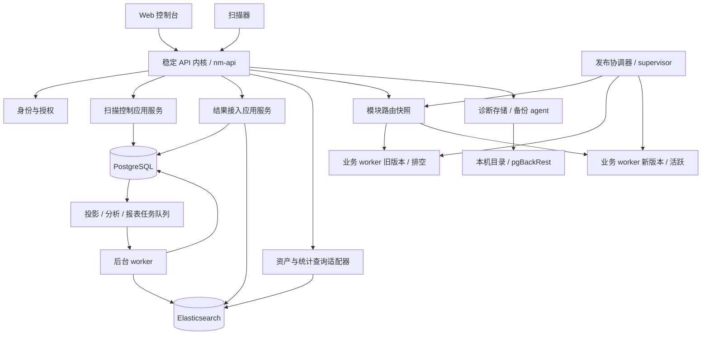
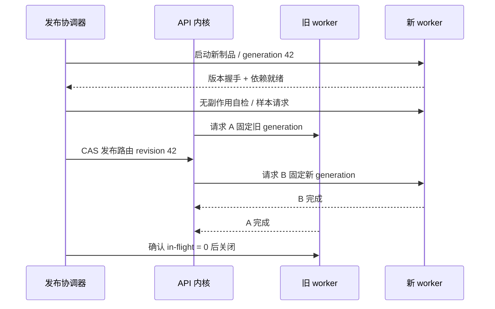

# 服务端模块化、部分热更新与独立部署方案

[文档中心](README.md) · [实现规格与接入步骤](MODULE_RUNTIME_IMPLEMENTATION.md) · [可运行原型](examples/modular-hot-update/README.md)

本文基于 `network_mapping_server` 0.1.27 的现有服务端代码设计。目标是让业务模块逐步独立开发、测试和部署，更新部分业务时保持 API 入口、登录会话和扫描器通信可用。

**建议采用：Cargo workspace 模块化 + 稳定 API 内核 + 可替换业务 worker + 版本化配置。** 第一阶段仍可单进程部署；按更新频率与负载逐步把 worker 拆成进程。配置热更新、业务代码替换和内核滚动升级是三条不同的发布路径。

当前实施状态：现有库入口业务已迁移到领域模块；运行时与纯渲染成为独立 workspace 包；生产报表已接入模块接口、独立渲染进程及管理员版本切换。具体可运行能力、配置、接口和边界以[实现说明](MODULE_RUNTIME_IMPLEMENTATION.md)为准。本文其余内容保留整体目标架构；未在实现说明中列为已接入的能力仍为后续设计。

## 1. 现有结构与必须保留的语义

### 1.1 改造前代码依据

| 现有位置 | 改造前职责与约束 | 对设计的影响 |
| --- | --- | --- |
| [`src/main.rs`](../src/main.rs) | 初始化数据库、ES、配置、中间件，直接启动大量 `tokio::spawn`，注册 HTTP 服务 | 抽出 composition root 与受管理的后台任务；不能复制一套启动流程来启动每个模块 |
| 改造前 `src/lib.rs` | 曾约 4,800 行，混合系统资源、密码、任务模型、调度、恢复、结果入库、DNS 子任务和加密 | 必须先按领域迁移，再形成 crate 边界 |
| [`src/config.rs`](../src/config.rs) 的 `init_routes` | 统一注册 Actix 路由 | 路由逐领域注册，业务调用通过稳定适配器转发；已构建的 Actix 路由不是可动态替换的代码 |
| [`src/runtime_config.rs`](../src/runtime_config.rs) | `RuntimeConfig<T>` 已使用 `Arc<RwLock<Versioned<T>>>`、revision 和 `watch`；持久化具有乐观并发控制与历史修订 | 保留现有格式，补齐全域同步、应用状态与兼容性检查 |
| [`src/lib.rs`](../src/lib.rs) 的 `apply_task`、恢复函数 | 任务领取使用事务、行锁和 `SKIP LOCKED`；`TASK_LEASE_MS = 90_000` | 延续既有任务租约，API 更新不能重置正在执行的扫描 |
| [`src/lib.rs`](../src/lib.rs) 的 `save_scanner_results` | 上传按 execution/upload/batch 身份与 checksum 去重；PG 回执和 ES 写入之间存在租约和重试 | 不引入第二套上传身份；不可把 PG 与 ES 写入误当成一个分布式事务 |
| [`src/elasticsearch.rs`](../src/elasticsearch.rs) | 原始结果与资产投影存储；后台投影工作 | 拆写入、查询、投影三种接口，复用稳定文档身份与 outbox |
| [`src/analytics_snapshot.rs`](../src/analytics_snapshot.rs) | PG 分析快照、outbox、抢占与恢复；当前存在全局任务串行化保护 | 可以独立运行，但多开实例不会自动获得线性吞吐提升 |
| [`src/reports/worker.rs`](../src/reports/worker.rs) | 报表计划、生成、投递混在同一个循环；已有 `claim_token`、五分钟租约与 `SKIP LOCKED` | 最先把纯渲染拆出去；投递副作用单独管理 |
| [`src/scan_migration.rs`](../src/scan_migration.rs) | 普通实例持共享存储运行锁，离线 PG→ES 迁移持排他锁 | 拆分后相关读写进程都必须纳入迁移隔离，不能遗漏 worker |
| [`src/scanner_diagnostics/mod.rs`](../src/scanner_diagnostics/mod.rs) | 诊断目录持有 `.storage.lock` 独占锁，另有进程内分片 Mutex | 多个完整实例不能共享同一诊断目录启动；应引入独立文件存储所有者 |
| [`src/main.rs`](../src/main.rs) 的备份恢复 | 启动时把所有 `queued/running` 备份标记失败 | 蓝绿启动新实例会干扰旧实例备份，必须先改为有所有者的超时恢复 |

配置同步的实际情况要以代码为准：`general` 有五秒刷新；`monitor/scanner_health` 通过 `refresh_health` 刷新；统计服务有自己的刷新与状态发布；报表邮件在生成时读取数据库。其余配置没有统一的全域刷新机制，不能假定多个 API/worker 实例会同时生效。

### 1.2 保持不变的外部契约

继续支持现有 Web 与扫描器 URL，如 `/api/task/create`、`/api/task/apply`、`/api/scanner/heartbeat`、`/api/scanner/result`。模块迁移初期不要求前端或扫描器改变调用方式。

保留 `scan_plan.version = 1`、既有 profile/能力匹配，以及结果协议的兼容处理。新增协议能力采用显式版本和能力协商，不能只根据 worker 自身版本推断扫描器支持程度。

PostgreSQL 继续作为用户、权限、任务、配置、回执、outbox 和派生分析快照的权威来源；Elasticsearch 继续作为原始扫描结果及端点投影的权威存储。正常运行不恢复已废弃的 PG 原始结果双写或回退。

现有 `session` 与 CSRF 数据在数据库中，保持 cookie、域名、密钥及验证语义兼容即可在业务 worker 更新时保留登录。现有扫描器是请求/心跳/任务上传模型；“保持在线”指避免中断这些通信与租约，不意味着迁移已有 TCP 连接到另一进程。

## 2. 热更新边界

| 更新内容 | 采用方式 | 生效边界 |
| --- | --- | --- |
| 阈值、开关、保留期、DNS 策略、自动目标参数 | 现有运行配置机制，补齐校验与多实例同步 | 新请求或下一次任务领取；请求内固定快照 |
| 邮件模板、报表模板、解析规则等数据 | 版本化资源包，先编译/校验再替换不可变快照 | 新报表或新任务；已归档报告不改写 |
| 报表渲染、诊断解析、独立查询计算等 Rust 业务代码 | 启动新版本进程，预热，切路由/领取权，旧版本排空 | 新请求走新代际，旧请求完成于旧代际 |
| 认证内核、中间件、HTTP/TLS 栈、共享 DTO 的破坏性变化 | 兼容迁移后滚动升级 API 内核 | 负载均衡停止给旧实例新流量，等待请求完成 |
| 数据库破坏性变更、ES 不兼容映射、扫描协议大版本变化 | 独立迁移与协调发布；必要时维护窗口 | 不能承诺任意在线替换或即时回滚 |

Rust crate 拆分只改善代码边界，并不使已链接到主程序的代码可以热替换。不要用 `libloading` 直接跨 `.so` 传递 Rust trait object、`String`、`Vec` 或 Tokio future：Rust ABI、分配器、依赖版本、静态状态和后台任务的卸载生命周期难以稳定约束。

只有已有成熟 C ABI、明确内存所有权及无残留任务的计算库才考虑本机动态库。WASM 可作为后续纯规则计算扩展点，但数据库访问、SMTP、备份与扫描控制不需要为了热更新全部改写为 WASM。

## 3. 目标架构与模块职责



第一阶段仅拆逻辑模块；第二阶段优先分离业务 worker 与运维 agent。低规模安装默认三个部署角色即可：`api`、`worker`、`ops`。报表或查询成为瓶颈后再把 `worker` 内某个模块独立部署，不要求一开始就有十几个微服务。

### 3.1 Cargo workspace

```text
network-mapping/
├── Cargo.toml                     workspace + 统一依赖版本
├── crates/
│   ├── nm-contracts/              内部 DTO、事件、错误码、协议 schema
│   ├── nm-platform/               连接池、时钟、日志、通用配置快照
│   ├── nm-identity/               登录、权限、Session、TOTP、凭据验证
│   ├── nm-scan-control/           任务生命周期、调度、节点能力、恢复
│   ├── nm-ingest/                 结果校验、幂等回执、ES 原始写入
│   ├── nm-asset-query/            搜索、资产详情、标签、查询编译
│   ├── nm-analytics/              投影、分析快照、统计读模型
│   ├── nm-reports/                报表计划、生成、模板、归档
│   ├── nm-notification/           邮件投递与发送状态
│   ├── nm-operations/             维护、诊断存储、备份
│   └── nm-module-runtime/         manifest、IPC、路由与生命周期
├── apps/
│   ├── nm-api/
│   ├── nm-worker/                 可用 --modules 选择运行模块
│   ├── nm-ops-agent/
│   ├── nm-module-supervisor/
│   └── nm-admin/                  迁移与维护 CLI
└── migrations/                    独立、带版本、可重复校验的迁移
```

依赖方向：`apps → 领域 crate → contracts/platform`。`platform` 不依赖任何业务领域；领域之间通过 contracts 定义的命令、只读查询和事件通信。尽量不让 `nm-reports` 直接依赖 `nm-scan-control` 的实现，更不能在两个 crate 中复制 `save_scanner_results`。

`nm-contracts` 不包含 Actix、数据库连接或 worker 生命周期。领域 crate 将 HTTP handler 与应用服务分开；只有 transport adapter 使用 `HttpRequest`、`web::Data` 和响应包装。禁止将现有 `lib.rs` 原样变成万能 `common` crate。

### 3.2 现有文件的迁移映射

| 模块 | 来源 | 状态所有权与公开能力 |
| --- | --- | --- |
| identity | `login.rs`、`admin.rs` 的身份部分、用户 handler、认证/CSRF 中间件、`lib.rs` 密码与凭据函数 | 管理 users/session/TOTP；公开认证与授权能力，不导出数据库 Row |
| scan-control | `lib.rs` 的 CreateTask/STask/apply/recover/aggregate、`handlers/task.rs` 控制部分、`scanner_config.rs`、`dns.rs`、`dns_follow_up.rs`、`target_generated` | 管理 scan_task、scan_task_execution、scanner_info 和生成去重状态；唯一拥有任务状态机写入入口 |
| ingest | `lib.rs` 的 observation/上传模型和结果保存、`handlers/task.rs` 结果上传部分、ES 写入部分 | 管理 scan_result_batch 和原始 observation；负责上传验证、稳定文档 ID、回执与写入 token |
| asset-query | `handlers/search*`、`handlers/assets.rs`、标签 handler、查询与搜索投影读取 | 对扫描事实只读；标签属于独立资产注释，不让标签操作改写扫描事实 |
| analytics | `analytics_snapshot.rs`、`statistics`、`elasticsearch/projection`、ES 投影 worker | 拥有派生分析表与索引、analytics/projection outbox 的消费；读模型可以重建 |
| reports | `reports`、`handlers/reports.rs`、`report_mail_assets`、邮件模板的报表渲染部分 | 管理 report_schedule/run/input/job/mail_asset、归档内容与模板版本 |
| notification | `reports/worker.rs` 的 send_one、`mail_template.rs` 发送部分、监控与节点离线通知 | 管理发送任务与投递状态，隔离 SMTP 副作用 |
| operations | `backup`、`scanner_diagnostics`、`system_maintenance`、资源采集 | 备份与诊断文件由指定 agent 管理，API 只查询或提交命令 |
| observability/runtime | `logs`、`audit`、`request_log`、`monitor`、`runtime_config`、`system_time` | 日志、审计、策略快照及任务监督；高频请求日志与可靠业务事件分开 |

初期允许同一个 PostgreSQL 数据库、同一 schema，但建立表写入所有权。跨模块联表读取可作为迁移过渡，不能因此赋予各 worker 任意更新权限。后续独立部署使用模块专属 DB role；核心交易暂不拆数据库，避免过早引入分布式事务。

**特殊交易边界：** 当前结果最终确认还会更新执行状态、任务聚合、创建 DNS 后续任务及 outbox。这些动作必须保留同一个 PG 事务。第一阶段用一个终结应用服务协调领域函数并共享 transaction；ingest 只允许通过该服务完成任务状态写入。后续进程拆分时，将最终确认转为带唯一键的 completion outbox，由 scan-control 在自己的事务中消费，明确允许短暂的状态延迟；不能简单把事务中每条 SQL 换成 HTTP 请求。

## 4. 稳定内核与可替换模块的接口

### 4.1 两种适配器共享同一业务端口

应用服务不关心部署方式，例如报表计算端口：

```rust
// 接口设计片段：DTO 来自 nm-contracts，业务错误在此省略。
use std::{future::Future, pin::Pin};

pub trait ReportRenderer: Send + Sync {
    fn render<'a>(
        &'a self,
        input: RenderReportInput,
    ) -> Pin<Box<dyn Future<Output = Result<RenderedReport, ModuleError>> + Send + 'a>>;
}
```

`LocalReportRenderer` 在进程内调用；`RemoteReportRenderer` 在 IPC 中调用独立 worker。切部署方式时 handler 仍调用相同的应用端口。这类 Rust trait 只用于**同一程序内部**，不会通过动态库或跨进程传递。

每个领域提供 `configure_routes(cfg)`，让 `config::init_routes` 只组合领域路由。已有路径绑定到稳定 handler，handler 通过模块路由快照调用远端能力。更新 worker 可以替换能力实现；新增 HTTP 入口、鉴权模型和中间件仍需升级内核。

应用组装时按领域注入 `IdentityServices`、`ScanServices`、`QueryServices` 等小型状态对象，不再让每个 handler 都取得整套数据库、全局配置和密码参数。`Bootstrap` 负责连接与角色选择，`ModuleRegistry` 保存能力绑定与路由快照，`Supervisor` 管理运行单元，`ConfigReconciler` 负责配置同步；这些对象在应用工厂外创建、在所有 Actix worker 间共享，避免在 `HttpServer::new` 的闭包中重复启动后台服务。

模块生命周期统一为 `prepare → ready → active → draining → stopped`，另有 `failed` 状态。依赖先准备后启动，停机按依赖的反向顺序执行。关闭报表生成时先停止新领取，保留已归档报表的查询；关闭扫描调度时停止分配新任务，但必须继续接收已执行任务的心跳和上传。核心接入模块不能作为普通可选功能直接卸载。新增独立 worker 能力通过注册表绑定；旧能力失效时其 handler 返回明确的不可用状态，前端只显示业务功能是否可用，不暴露内部进程或发布协议。

### 4.2 IPC 与版本协商

同机首选父子进程管道或 Unix domain socket；独立机器使用 HTTP/gRPC + 服务身份验证。初版使用现有 serde/JSON 和 reqwest，避免为了模块化同时更换协议栈。JSON 外加长度前缀，限制帧大小；socket 模式复用连接与限制并发，stdout 管道模式必须把日志写入 stderr。

生产 RPC 请求建议为：

```json
{
  "rpcVersion": 1,
  "requestId": "019c0000-0000-7000-8000-000000000001",
  "module": "report-render",
  "releaseId": "report-render-1.2.0-sha256prefix",
  "generation": 42,
  "method": "render",
  "deadlineAtMs": 1791849605000,
  "context": {"actorId": 12, "scope": "report:read", "configRevision": 18},
  "payload": {"reportId": "019c0000-0000-7000-8000-000000000002", "inputChecksum": "sha256"}
}
```

context 由已认证的内核生成，不能直接相信浏览器提交的 actor/scope。响应返回相同 requestId、releaseId、generation，包含业务数据或稳定错误码。大报表、图片和结果批次通过受控流或对象引用传递，避免把大字节数组重复编码进 JSON。

建议错误码包括 `MODULE_NOT_READY`、`MODULE_BUSY`、`DEADLINE_EXCEEDED`、`SCHEMA_INCOMPATIBLE`、`REVISION_CONFLICT`、`CLAIM_LOST`。只读请求按剩余 deadline 有界重试；写入只有存在端到端幂等键才允许重试。控制面失效时继续使用最后已确认的兼容版本，不能在无可用模块时伪造成功响应。

### 4.3 发布 manifest

```toml
module_id = "report-render"
version = "1.2.0"
release_id = "report-render-1.2.0-sha256prefix"
runtime = "process"
artifact = "bin/nm-report-render"
artifact_sha256 = "完整 SHA-256"
target = "x86_64-unknown-linux-gnu"
rpc_versions = [1]
capabilities = ["report.render.v1"]
max_inflight = 8
request_timeout_ms = 5000
drain_timeout_ms = 30000

[compatibility]
host_api_min = 1
host_api_max = 1
database_schema_min = 27
database_schema_max = 28
input_schema = "report-input.v1"
output_schema = "rendered-report.v1"

[configuration]
namespaces = ["report_mail", "general"]

[requirements]
analytics_read_api = "v1"
```

manifest 不开放任意 URL、shell 命令或任意环境变量注入。发布协调器仅从可信制品仓库获取制品，校验签名、摘要、平台、协议及依赖；SHA-256 校验完整性，签名或可信仓库身份负责真实性。制品目录不可变，同版本不同摘要禁止覆盖。依赖清单按能力契约校验并检查循环；相关模块需要成组发布时使用同一个路由 bundle revision。

## 5. 热更新生命周期与切换算法

### 5.1 同步请求的切换



1. **prepare**：加载并校验制品，确认新旧协议、配置与 schema 都兼容；不修改活跃路由。
2. **start/warm**：启动新进程；建立连接、准备规则和模板；探针检查真实依赖。新进程此时禁止抢任务、发邮件或修改生产状态。
3. **verify/canary**：无副作用样本比对；只读能力可按稳定 request/report ID 进行灰度。写入 worker 的灰度要靠明确任务归属，不能把同一个任务同时投给新旧版本。
4. **activate**：基于 expectedRevision CAS 更新持久化路由和发布事件；内核用一次短锁替换整个不可变路由快照。
5. **drain**：旧版本不接受新请求、不领取新任务；已持有其句柄的请求继续完成。多个内核实例汇报各自已应用 revision。
6. **retire**：确认所有入口切换完成且旧请求、旧任务、后台资源归零，再关闭旧进程；保留制品和发布历史供回滚。

一次请求开始时获取 `Arc<RouteSnapshot>` 并保存至整个请求链；不能在处理步骤之间重复取“当前版本”，否则会把旧输入送给新实现。`RwLock`/Mutex 只覆盖句柄读取或替换，网络调用、预热、渲染和数据库操作都在锁外。

`Arc` 只能证明本机同步请求的句柄生命周期，不能证明远端任务或 detached `tokio::spawn` 已完成。长任务另外使用持久化任务租约和 in-flight 统计。模块内部所有任务必须被 `JoinSet`/监督器追踪，禁止藏在构造函数里自行永久 spawn。

Rust 示例原型使用短 `Mutex` + `Arc<Worker>`；生产吞吐确认有需要后可采用 `ArcSwap<RouteSnapshot>`，但原子句柄交换不会替代任务租约、集群配置同步或完整回滚流程。

### 5.2 后台任务的新旧版本交接

后台 worker 不经过 API 请求路由，因此**只切 API 的路由不够**。领取事务必须检查模块活跃 generation，旧代际不再具有领取权。

为现有任务增加 `assigned_generation`、`claim_owner_instance`、必要的 `payload_schema_version`。已有 `claim_token` 与 lease 的队列继续复用；分析快照当前用 `locked_at` 等状态，可逐步补为显式 token。领取示意：

```sql
-- 拟实现：部署行的共享锁与激活事务的更新锁互斥，定义领取切换边界。
BEGIN;
SELECT generation, release_id
FROM module_route
WHERE module_id = 'reports'
FOR SHARE;
-- 应用校验：generation = 本实例代际；不是则回滚且不领取。

WITH picked AS (
    SELECT report_id FROM report_job
    WHERE status IN ('pending', 'retry_wait') AND available_at <= NOW()
    ORDER BY available_at, report_id
    FOR UPDATE SKIP LOCKED LIMIT 1
)
UPDATE report_job AS job
SET status = 'running', claim_token = $1,
    lease_until = NOW() + INTERVAL '5 minutes',
    assigned_generation = $2, claim_owner_instance = $3,
    attempts = attempts + 1
FROM picked WHERE job.report_id = picked.report_id
RETURNING job.*;
COMMIT;
```

执行时保留 token 与 generation；需要较长处理时每 30 秒续租一次，续租必须带 token 且原租约尚未过期。完成事务同样以 token、任务状态和有效租约条件更新；受影响行数为零则拒绝陈旧提交。

**旧 generation 的已领取任务仍可完成，不能仅因模块切换而禁止其提交。** 活跃 generation 限制“领取”，claim token 限制“完成”。租约失效并被新 worker 接管后，旧 token 才失去提交权。重试前校验新版本能读旧任务输入，不能用新代码解释未知版本的 payload。

租约使用 PostgreSQL 时间，避免不同机器时钟决定所有权。失联 worker 在租约过期后由其他实例恢复；`drain_timeout` 不是租约过期时间。同步 RPC 可取消，长任务优先完成或可恢复检查点，不应在 30 秒超时后直接杀死五分钟的报表或长时间备份。

### 5.3 多实例发布与回滚

`module_route` 是持久化的期望路由，各内核通过通知加轮询加载快照，并保存已应用 revision。发布 API 返回 `202 + deploymentId`；状态分别展示 prepared、activating、converged、draining、completed。只有所有纳入发布的健康入口已确认新 revision，才能宣称集群切换完成。

通知不是全局原子广播，传播期间会有新旧版本并存，因此发布必须保证兼容窗口。如果业务要求一个更新瞬间全局生效，采用集中网关或临时停止该模块的新请求，等所有入口就绪再放行。

准备失败保持旧路由；激活后失败可以把旧制品发布为**新的 generation/revision**，不能把 revision 倒退。回滚只改变后续执行代码，不撤销已经成功写入的数据、已创建任务或已发送邮件。已有副作用按业务补偿或人工恢复处理。

## 6. 发布控制面与配置系统

### 6.1 新增控制表

下面为最小表结构建议；独立 migration 应补充模块注册、外键策略、状态检查、审计与索引，不直接加入当前初始化 SQL 后让每个 worker 启动执行。

```sql
CREATE TABLE module_release (
    release_id TEXT PRIMARY KEY,
    module_id TEXT NOT NULL,
    version TEXT NOT NULL,
    artifact_sha256 TEXT NOT NULL,
    manifest JSONB NOT NULL,
    created_at TIMESTAMPTZ NOT NULL DEFAULT NOW(),
    UNIQUE (module_id, version)
);
CREATE TABLE module_route (
    module_id TEXT PRIMARY KEY,
    release_id TEXT NOT NULL REFERENCES module_release(release_id),
    generation BIGINT NOT NULL CHECK (generation > 0),
    revision BIGINT NOT NULL CHECK (revision > 0),
    updated_at TIMESTAMPTZ NOT NULL DEFAULT NOW()
);
CREATE TABLE module_instance (
    instance_id UUID PRIMARY KEY,
    module_id TEXT NOT NULL,
    release_id TEXT NOT NULL REFERENCES module_release(release_id),
    generation BIGINT NOT NULL,
    state TEXT NOT NULL,
    applied_route_revision BIGINT,
    last_heartbeat_at TIMESTAMPTZ NOT NULL,
    inflight_count INTEGER NOT NULL DEFAULT 0,
    last_error TEXT
);
CREATE TABLE module_deployment (
    id UUID PRIMARY KEY,
    module_id TEXT NOT NULL,
    target_release_id TEXT NOT NULL REFERENCES module_release(release_id),
    expected_revision BIGINT NOT NULL,
    state TEXT NOT NULL,
    requested_by INTEGER,
    change_reason TEXT NOT NULL,
    created_at TIMESTAMPTZ NOT NULL DEFAULT NOW()
);
```

generation 标识一次运行代际，releaseId 标识不可变制品，revision 标识发布次序；多模块 bundle 用独立 bundle revision 形成整体快照。一个 release 可被回滚后再次激活，但必须分配新 generation。

激活事务同时完成路由 CAS、部署状态、可靠发布 outbox 和操作审计；提交后发送唤醒通知。协调器重启时根据部署表与实例实际状态恢复，不依赖内存中的“已切换”标记。

拟新增管理接口：

| 接口 | 行为 |
| --- | --- |
| `GET /api/modules` | 模块能力、制品版本、活跃代际、各实例状态 |
| `POST /api/modules/{id}/releases` | 导入已签名制品并校验 manifest；不执行任意上传的程序 |
| `POST /api/modules/{id}/deployments` | expectedRevision + targetReleaseId + changeReason，创建预热与发布任务 |
| `GET /api/module-deployments/{deploymentId}` | 查看激活传播、排空和错误 |
| `POST /api/modules/{id}/rollback` | 将已知兼容旧制品按新的 revision 发布 |
| `GET /api/modules/{id}/configuration-status` | 查看各实例已应用的 namespace revisions |

沿用管理员认证、CSRF、请求 ID 和审计。管理接口负责提出期望状态，独立 supervisor 负责执行；公共 API 进程无需具有写可执行文件目录或启动任意二进制的权限。

### 6.2 扩展现有运行配置

保留现有 `/api/config/runtime/{namespace}`、camelCase 发布请求、revision 历史和 `RuntimeConfig::replace` 的单调更新语义。

补齐流程：

1. 校验 namespace 的完整 document、schemaVersion 以及当前所有活跃/排空版本的配置兼容范围。
2. 在原配置事务中递增 revision、写历史、写可靠变更事件/审计；事务提交后 PostgreSQL `NOTIFY` 唤醒订阅者。
3. 每个角色用**专用连接**执行 `LISTEN` 并持续驱动连接 future；断线重连后先全量刷新。不能借用连接池连接暂时 LISTEN 后归还。
4. 每五秒兜底轮询该角色订阅的所有 namespace revisions。通知只用于降低延迟，数据库文档是权威来源。
5. 解析、校验、预编译成功后替换快照，再上报 appliedRevision；失败保留最后有效快照并报告落后，不覆盖为半成品。
6. 超过设定同步容忍期的关键授权策略实例停止领取新任务，避免长期使用旧授权；非关键展示配置可继续使用最后有效值。

回滚配置应读取历史 document 并发布为新 revision。现有历史表可复用，但当前尚无运行配置历史/回滚 HTTP API，应明确另行实现。

跨 namespace 有耦合时定义配置 bundle 与单个 bundle revision；先构造完整有效快照再替换。`watch` 只通知同进程消费者，不负责多进程或跨机器同步。

DNS 后续任务和扫描授权采用双重规则：创建时保存策略版本与计划；执行/生成后续目标时仍检查**当前授权限制**。新策略收紧时不得仅因为旧任务保存了宽松范围就继续扩展扫描。模式、模板等可重现计算输入固定版本，授权撤销则即时限制后续副作用。

## 7. 数据一致性、副作用与异常恢复

### 7.1 扫描上传与 ES 投影

继续以 `(execution_id, upload_id, batch_index)`、payload checksum 和稳定 ES 文档身份为重试依据。重试必须保持原 observation 的 observed_at 与批次内容，不在更新后重新生成身份。

PG 提交、ES 写入和回执确认之间允许进程崩溃。已有 batch 写入 token 与租约机制需要保留并测试这些窗口；新旧写入版本必须生成兼容的文档键。只有 ES 所需写入已成功、回执状态和 final 连续性符合现有协议时才返回成功，不能为了异步拆分提前确认尚未持久化的结果。

投影和分析使用已有 `scan_projection_outbox`、`analytics_outbox` 等持久化队列；事件消费按 execution/事件唯一键幂等。可靠业务事件不使用 `request_log` 的可丢弃内存 channel。首期继续 PostgreSQL outbox，不引入 Kafka/RabbitMQ 作为拆分的前提。

### 7.2 邮件投递

报表生成与 SMTP 发送分离。渲染输出、模板版本、收件人快照和 content checksum 先持久化，再进入独立投递队列。

当前 `report_delivery` 已有 token 与五分钟租约，但邮件服务器接受邮件后、PG 标记 sent 前崩溃仍可能造成重发。普通 SMTP 无法仅靠数据库 token 提供严格 exactly-once。沿用稳定 Message-ID 便于追踪；若必须避免重复，需要支持幂等键的投递服务或把不确定状态标为 unknown 并复核，不能把未知结果当成必然未发送。

热更新期间停止旧发送器领取新任务，允许已进行的 SMTP 操作完成，避免直接杀进程制造不确定发送窗口。监控通知与节点离线通知也应逐步进入同一可靠投递端口。

### 7.3 备份与诊断

备份已有数据库全局“单个活跃任务”的部分唯一索引；`BackupManager` 另有本机 Semaphore。保留数据库约束并增加 ownerInstance、claimToken、leaseUntil、外部进程状态。新实例只恢复租约已过期且确认执行所有者失效的任务，移除“启动就失败所有未完成备份”的全局更新。

租约不能停止已运行的 pgBackRest 进程。agent 重启后要结合本机进程监督或 pgBackRest 状态判断，确认旧执行未运行后才能接管。无需为了模块更新迁移正在执行的外部进程；备份 agent 可延后升级。

诊断目录继续由单个 ops agent 持有独占锁，API 通过该 agent 上传、组装和下载。同机双 agent 更新时先完成文件作业并转移目录所有权；跨机器部署再评估对象存储、数据库文件元数据和分布式作业租约。不能直接删除 `.storage.lock` 来支持多实例。

### 7.4 故障决策

| 故障 | 系统行为 |
| --- | --- |
| 新制品启动/握手/自检失败 | 标记本次 deployment 失败，旧路由和旧领取权保持 |
| CAS revision 冲突 | 返回 409/冲突状态，读取当前发布状态后决定下一次操作 |
| 模块崩溃 | 同步请求返回可识别错误；监督器按退避重启或回滚；有 token 的长任务按租约恢复 |
| 控制面数据库暂时不可用 | 已加载的只读计算可继续；需要 PG 提交/领取的操作失败或等待，不伪造持久化成功 |
| 通知丢失 | 轮询和重连全量刷新补偿；展示 desired/applied 的差异 |
| 排空超过时限 | 标记 degraded 并明确阻塞任务；有可恢复检查点才强制结束 |
| 新版本写入不兼容数据 | 停止后续派发；按预定数据修复/迁移流程处理，不能声称二进制回滚已修复数据 |

## 8. 生命周期、资源与部署细节

### 8.1 后台监督器

把 main 中散布的永久 spawn 包装为受监督服务。每个角色显式注册服务名、启动依赖、重启退避、停止信号和 JoinHandle。可使用 `tokio::sync::watch` 发送停止意图、`JoinSet` 管理任务；现有 Tokio 足够实现第一版。

停止顺序：撤销 readiness → 停止领取/接收新任务 → 等待在途业务 → 刷新可保存缓冲与检查点 → 停止资源采集/通知 → 关闭连接与退出。请求日志仍可保留当前有界、允许丢弃的策略，但业务事件和审计不能套用这种语义。

`MonitorHandle::new` 当前内部启动通知与慢 SQL 任务，迁移时改为返回可启动/关闭的运行单元。worker 启动不能隐式执行创建管理员、全局备份恢复、全库 DDL 等副作用。

readiness 检查契约、配置、依赖和必要索引；liveness 只检查进程是否能响应。候选版本健康检查不能自动发邮件或真实扫描目标。API 内核避免把全部可选模块异常都升级为整个 API 不可用；按能力返回故障或降级读路径。

### 8.2 数据库与连接预算

迁移由独立 `nm-admin migrate` 一次执行，持迁移排他锁，记录 schema version 与 checksum。各应用启动仅检查 schema 兼容范围。普通运行角色纳入存储共享运行锁；锁连接失效必须使相关 worker 失去 readiness/领取能力，而不是仅记录警告继续运行。

兼容迁移采用 expand → 新代码 → 数据回填 → 停旧版本 → contract。删除列、改变字段语义或 ES 字段类型不能在旧版本还运行时执行。索引大规模变化采用新版本索引、回填、验证、再切 alias，并保留回滚读路径。

拆分后每个进程都有连接池。示例预算：2 个 API × 10 + 2 个普通 worker × 4 + 1 个 ops × 2 = 30；报表蓝绿窗口额外 2 个连接，再预留 LISTEN、运行锁、迁移与运维连接。根据实际 PostgreSQL 上限校验总量，不能每个模块默认再开十个连接。

现有 PG 客户端使用 `NoTls`，`database.tls` 不是可用加密实现；跨主机 worker 需要先补齐实际 PG TLS 或受保护链路。同机分进程不因此引入新的跨机器数据库链路。

### 8.3 制品和运行角色

```text
/opt/network-mapping/releases/
  api/<version>/...
  report-render/<release-id>/manifest.toml + bin/...
/etc/network-mapping/              配置与证书
/var/lib/network-mapping/          发布状态缓存、诊断数据
/run/network-mapping/              同机 IPC socket
```

服务用户只读制品，supervisor 验证并启动固定入口，ops agent 独占必要文件目录。密钥不打包到模块制品，也不把全部服务端配置复制给每个模块。报表渲染器不需要 scanner pepper、登录加密密钥或 SMTP 凭据。

拟实现角色命令：

```sh
nm-admin migrate --config /etc/network-mapping/config.toml
nm-api --config /etc/network-mapping/api.toml
nm-worker --modules projection,analytics,reports --config /etc/network-mapping/worker.toml
nm-ops-agent --config /etc/network-mapping/ops.toml
nm-module-supervisor --config /etc/network-mapping/modules.toml
```

单机使用 systemd 托管角色；跨机器或 Kubernetes 使用同样的角色与制品契约。API 滚动发布需要独立 readiness、连接排空、至少一个健康副本及负载均衡；无需把 Kubernetes 作为实现热更新的先决条件。

### 8.4 可观测性与初始阈值

日志贯穿 requestId、executionId/reportId、moduleId、releaseId、generation、routeRevision、configRevision、instanceId；不输出 token、密钥、原始凭据。指标记录请求数、失败率、p95/p99、队列积压、租约恢复、在途数、配置落后和排空耗时。

建议初始参数：预热 30 秒；普通计算 RPC 5 秒；同步请求排空 30 秒；配置兜底同步 5 秒；实例心跳 5 秒。后台任务租约按最坏执行时间制定，报表保留现有五分钟起点并补续租。以上是配置初值，不是已验证容量或停机承诺。

只读模块可先 5% 稳定分流，再 25%、100%；写入模块按任务类型或队列 cohort 分配。持续错误率超过基线容忍阈值或队列延迟超过 SLO 时停止扩量。若要保证 API 不间断，应验收业务 worker 更新期间登录、心跳、上传和查询成功率，而不是只观察进程仍存活。

## 9. 首个完整试点：报表渲染热更新

选择报表的纯渲染能力作为首个试点：输入可以固定，输出可校验，不需要改变扫描器协议，并且模板/图表计算更新较频繁。

从 `reports/worker.rs` 拆出三个阶段：

1. 领取 report_job，获取 report_run 的任务快照、周期、统计 payload、模板源码/版本、report_mail/general 修订；固定 inputChecksum。
2. 在数据库事务外调用 `ReportRenderer`。输入不含 DB client 或密钥；输出 HTML、纯文本、图表字节/受控引用、输入校验和与渲染器版本。API/应用服务校验输出大小、资源格式和模板约束。
3. 开短事务重新验证 claimToken、有效租约和未完成状态，存档 payload、rendered_mail、contentChecksum、rendererReleaseId、rendererGeneration；同事务更新任务状态并创建投递记录。

当前生成流程在 PG 事务中做多项计算，不能仅把中间调用改成远端请求后继续长时间持有行锁。先捕获稳定输入，锁外计算，再使用 token 和状态进行提交保护。需严格一致的统计输入应在捕获阶段确定 cutoff/快照，避免渲染前后任意重查而混用数据。

渲染器 v2 预热后，新 report_job 使用新 generation；旧 report_job 在 v1 完成。更新期间已归档邮件和图片保持内容可复现，重新生成走现有“新 revision/supersedes”语义，不覆盖已发送报告。

首期保持计划调度、结果存档、邮件发送在宿主应用，只把 `ReportRenderer` 变为可替换进程。完成验证后再独立化整个报表 worker，最后迁移投递端口；这个顺序可避免第一次试点同时引入数据库所有权和 SMTP 去重变更。

## 10. 实施顺序与验收

| 阶段 | 实施内容 | 进入下一阶段的验收条件 |
| --- | --- | --- |
| A：领域整理 | lib.rs 按模块移动；handler/应用服务/存储分层；各领域注册路由；兼容 re-export 逐步淘汰 | API 路径、响应、权限和扫描任务行为保持；现有测试通过 |
| B：workspace 与生命周期 | 建立 contracts/platform；受监督后台任务；统一角色配置；独立迁移 CLI | worker 无隐式启动副作用，启动/停止可观测，可完成排空 |
| C：多实例前置 | 全域配置同步；备份恢复改 owner/lease；诊断独立 agent；完整迁移隔离 | 两个 API 实例共存，配置最终一致，新实例不干扰旧任务或目录 |
| D：渲染热更新试点 | IPC、manifest、路由快照、发布状态和代际；抽取 ReportRenderer | 新旧渲染并存；更新不影响登录/心跳/上传；失败制品不激活；可回滚 |
| E：任务 worker 拆分 | 投影、分析、报表按角色部署；领取代际与 token fencing；可靠 outbox | 崩溃恢复、超时接管、陈旧提交拒绝；任务不丢失，幂等约束成立 |
| F：按负载服务化 | 搜索/统计/通知独立扩缩，跨机器 IPC 与权限 | 有可量化瓶颈和容量收益；不因拆分突破 PG/ES 资源预算 |

实施工作量需要结合团队、现有测试与部署环境评估；不能仅从文件数量给出可靠工期。优先交付 A–D，足以让一个高频变化的业务能力独立热更新，再按收益推进 E–F。

生产验证应覆盖：

- 配置双发布冲突、NOTIFY 丢失、监听重连、无效文档保留旧快照、关键授权策略收紧。
- 旧请求在切换前取得句柄，跨切换完成仍使用旧实现；新请求使用新实现；失效候选不影响活跃路由。
- 任意候选启动、激活持久化、路由应用、旧任务排空窗口的协调器崩溃与恢复。
- 长任务过租约后旧 token 无法提交；旧 generation 已领取任务在租约有效时仍可完成。
- ES 成功/PG 未确认、PG 回执已存在/客户端未收到响应、final 批次重复等现有上传幂等窗口。
- 新实例启动不误标旧备份；诊断文件目录只由授权 agent 持有；迁移锁不会漏掉独立 worker。
- SMTP 接受后状态未落库的未知结果处理，以及报表归档的版本与内容可复现。
- 满负载蓝绿更新的成功率、队列延迟、内存峰值、连接峰值、停止与回滚耗时。

## 11. 本次交付与验证边界

[`docs/examples/modular-hot-update`](examples/modular-hot-update/README.md) 提供只依赖 Rust 标准库的原型，编译出业务行为不同的 v1/v2 二进制，使用父子进程管道完成握手、健康探针、自检、CAS 激活、请求版本固定、旧进程排空和回滚。

该独立原型验证进程替换的核心生命周期，不接入现有 Actix 服务、PG、ES、扫描器、生产鉴权或部署控制表；也不实现集群共识、完整 manifest 签名、跨模块依赖和长任务租约。运行时和渲染实现现已位于独立 workspace 包，并已接入生产报表工作流，具体能力和边界见实现说明。生产改造按上述阶段和[实施步骤](MODULE_RUNTIME_IMPLEMENTATION.md)进行。
