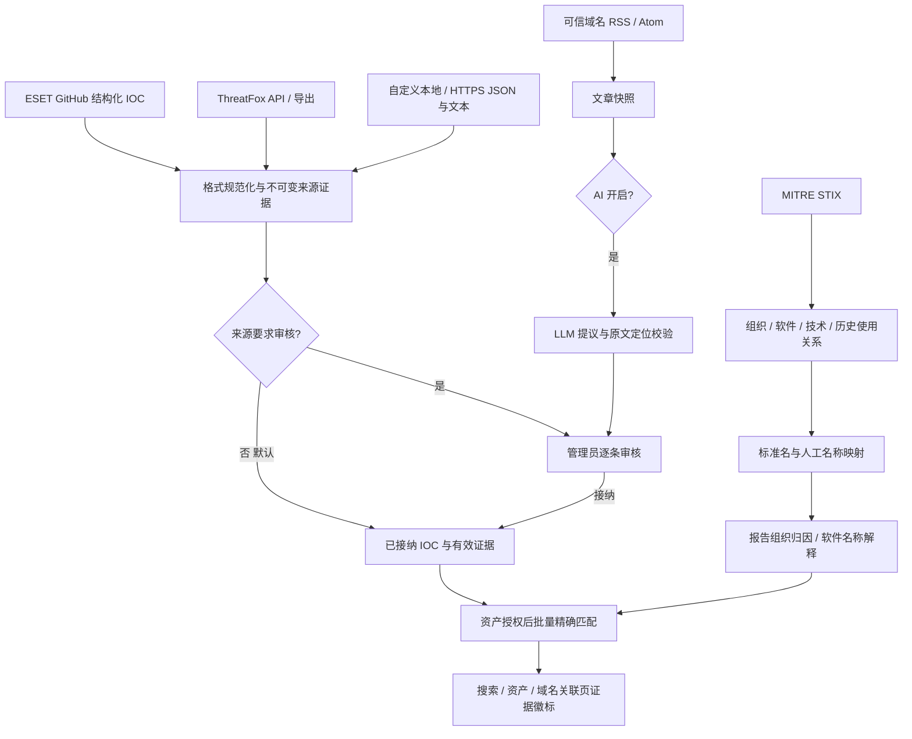

# 威胁情报、可信 IOC 与 AI 审核

[功能概览](FEATURES.md) · [部署](DEPLOYMENT.md) · [搜索](SEARCH_SYNTAX.md)

## 行为约定

可信来源的结构化 IOC 默认直接接纳，不使用置信度阈值、两个来源或 AI 开关作为门槛。
管理员可以在“设置 → 威胁情报 → 来源”打开某个来源的“结构化 IOC 需要人工审核”。
类型与格式校验仍然执行，无法解析的内容不会被伪造为有效 IOC。

RSS 文章由 AI 生成的提议始终需要人工审核。Web、API 均没有关闭 AI 审核的选项；数据库
还会检查证据来源、对应记录和内容哈希的审核决定。AI 输出不能指定 origin、审核状态或
信任标志。关闭 AI 只暂停新提取，不影响可信 IOC 同步、已有已审核 IOC 或自动标记。

接纳、恶意判定和组织归因是不同事实。ThreatFox 的 malware、confidence、reporter、tags
均作为来源元数据；软件家族不会自动生成组织归因。MITRE 关联名称可能部分重叠，只有
标准名称、明确有效的 G 编号或人工核实的来源名称映射可用于标准组织展示。

## 实现方案与取舍



PostgreSQL 保存来源策略、同步作业与文件游标、MITRE 实体和关系、名称映射、文章快照、
证据记录及审核历史。`intel_record` 保留提议和版本；只有接纳时才建立 `intel_ioc`。
`intel_published` 仅提供已接纳且未到期证据。数据库约束与触发器执行 AI 发布门槛，
Web 开关只影响处理队列。配置与人工决定使用现有审计日志。

首版使用 PG 的名称/关联名称候选检索，避免为规模较小的 MITRE 目录增加 ES 双写一致性
任务。模糊候选不自动确认身份。IOC 标记也在资产授权后的读取阶段计算，因此审核、撤销、
到期与名称映射调整不需要等待 ES 重建。ES 仍负责原有资产搜索和权限过滤。

不物化 `IOC → software → actor` 派生归因。MITRE 对象详情可查看软件的已报告使用关系，
这些关系不会进入当前 IOC 的 actor 字段、自动标记或审核通过条件。MITRE、ThreatFox 和
ESET 分别承担规范化、IOC 提供和报告分析角色，不作为三个独立归因来源计数。新增厂商
报告时应保存独立报告证据，不能通过重复转载形成交叉验证。

## 默认来源与周期

首次迁移创建以下来源。它们可以编辑、停用和立即同步；周期范围为 60～2,592,000 秒。
数据保存在 PostgreSQL，重启不会覆盖管理员修改。

| 来源 | 默认周期 | 默认接纳方式 |
| --- | ---: | --- |
| MITRE Enterprise STIX 2.1 | 86,400 秒 | 更新组织、软件、技术和关系基准库 |
| ESET malware-ioc GitHub | 3,600 秒 | 结构化 IOC 直接接纳 |
| ThreatFox recent API | 1,800 秒 | 结构化 IOC 直接接纳 |
| ESET WeLiveSecurity RSS | 1,800 秒 | 发现文章；AI 启用后生成待审提议 |

自定义 JSON、文本/CSV 来源默认 1,800 秒；ThreatFox JSON 导出默认 86,400 秒。
停用停止后续同步，不删除历史证据。修改免审策略后，新/重读的结构化记录按新策略处理；
已有批准记录不会因打开审核开关而被自动撤销。关闭结构化审核后，再次同步可接纳此前
等待中的结构化记录；AI 提议不会被这一操作接纳。人工拒绝、撤销的同版本记录不会因
普通重试重新生效。

## 本地文件与远程来源

本地根目录由服务端环境变量 `NM_INTEL_LOCAL_ROOT` 指定，默认为
`/var/lib/network-mapping/intel`。Web 填写根目录内的相对文件路径，例如
`eset/feed.json`。路径穿越、目录和指向根目录外部的符号链接均被拒绝。服务进程只读取
文件，不修改来源文件。容器部署时将文件目录只读挂载到配置的根目录即可。

远程来源使用 HTTPS、443 端口和完整域名白名单。来源 URL、RSS 文章地址与 GitHub
文件获取均执行边界检查；不跟随重定向，不访问私网、环回、链路本地或云元数据地址。
使用系统 HTTPS 代理的部署还应在代理侧执行公共目的地址限制，因为代理可能自行解析
DNS。保持 TLS 校验和系统 CA 信任；报告内的 IOC 不会被主动访问，也不会创建扫描任务。

IPv4 抓取按精确特殊用途前缀拒绝文档示例、基准测试、共享地址、退役 6to4 中继、私网和
保留地址，并对 IPv4 映射 IPv6 执行同一判断；例如拒绝 `192.0.0.0/24`，不会扩大到整个
`192.0.0.0/16`。这只限制抓取地址，IOC 自身仍可保存这些网段作为离线证据。

凭据仅通过服务端环境变量引用提供，名称须以 `NM_INTEL_` 开头。例如：

```text
NM_INTEL_LOCAL_ROOT=/var/lib/network-mapping/intel
NM_INTEL_THREATFOX_AUTH_KEY=<由部署环境注入>
NM_INTEL_AI_API_KEY=<由部署环境注入>
```

Web 只保存变量名称、显示是否已配置，不返回密钥值。ThreatFox API 使用 `Auth-Key`；
其他结构化 HTTPS 来源若配置 auth_env，值用作 Authorization 请求头。需 Bearer 的来源
应在该变量中提供完整 `Bearer …` 值。AI 凭据变量保存原始密钥，由客户端添加 Bearer。
ThreatFox 导出地址可使用路径占位符 `{AUTH_KEY}`，运行时以 URL 编码后的密钥替换。
不要将实际密钥直接写入 URL、文档或 Git。

## 数据格式

### JSON

支持顶层数组，或 `{"iocs":[...]}`。以下为可导入的示例数据，不会触发目标访问：

```json
{
  "iocs": [
    {
      "type": "ip_port",
      "value": "192.0.2.20:443",
      "verdict": "malicious",
      "external_id": "report-2026-endpoint-1",
      "malware": "报告中的软件名称",
      "confidence": 20,
      "reference": "https://research.example/report",
      "evidence": "来源明确将该端点列为攻击基础设施。"
    },
    {
      "type": "domain",
      "value": "suspicious.example",
      "verdict": "suspicious"
    }
  ]
}
```

支持 `ip`、`ip_port`（兼容 `ip:port`）、`domain`、`url`、`md5`、`sha1`、`sha256`。
可选字段包括 `actor_name`、`actor_id`、`techniques`、`victim_industries`、
`victim_countries`、`first_seen`、`last_seen`、`valid_until`。verdict 默认为 malicious，
也支持 suspicious。未知字段报格式错误，不能用于注入审核状态。

IOC 保留原始证据中的角色：受害行业和地区是报告上下文，不会被标记成攻击基础设施。
结构化组织归因需要有效 MITRE 组织和明确引用/证据；单纯 malware 或路径中的组织名不
能产生归因。AI 的全部字段仍须人工核对。

### 文本、CSV、Markdown 与 ZIP

文本支持每行一个完整 IOC、空行和 `#` 注释，不从任意正文中用正则挖取 IP。
CSV 使用首行字段名，例如 `type,value,malware,confidence,reference`。
ESET Markdown 仅解析明确的哈希、域名、IP、URL 表格列，不把 Filename 列当成域名。
YARA、Snort 和不支持的 JSON 结构不导入为 IOC，GitHub 作业摘要记录不支持的文件数。

JSON/CSV 导出可包在只含一个数据文件的 ZIP 中；只在内存中读取，不向文件系统解压。
拒绝嵌套 ZIP、多文件 ZIP，以及超出 96 MiB 解压/读取上限的输入。单次结构化输入最多
50,000 条。超限应在来源侧拆分为多个可独立更新的数据源。

### ThreatFox

默认 API 调用 `get_iocs`，请求最近 7 天。该接口按 first_seen 筛选，首次导入及超过
7 天的停机补采应添加 ThreatFox JSON 导出来源，或导入可信本地镜像。导出支持 API
data 数组及官方按 ID 分组的 JSON/ZIP。完整导出下载地址以当前认证门户为准。

来源置信度不会过滤 IOC。保存 first_seen、last_seen、reporter、reference 和恶意软件
名称；能够解析 first_seen 时记录 ThreatFox 自身的六个月有效期。到期证据保留历史，
不再贡献当前自动标记。抓取时间不会给旧记录续期。滚动窗口中未出现某条记录不表示撤回。

官方说明：[API](https://threatfox.abuse.ch/api/)、[导出](https://threatfox.abuse.ch/export/)。

### ESET GitHub

默认来源读取 `eset/malware-ioc` 的递归 Git 树，分批获取变化文件，每批最多 20 个，
尚有文件时 5 秒后继续。文件内容的 Git blob OID 与清单核对后才解析，避免上游更新
期间混合快照。文件哈希游标保存在数据库，重复同步不会重复创建同版本证据。
仓库目录名不用于自动组织归因，README、YARA、Snort 规则不作为 IOC 文本导入。

原生 MISP JSON 支持 `Event` 与 `response` 封装，读取事件及对象中的 Attribute，仅导入
Network activity、Artifacts dropped、Payload delivery 类别的目标 IP、域名、URL 和哈希。
不导入受害目标、来源链接、已删除属性或邮件上下文。旧 ESET 导出的 to_ids=false 不作为
可信 IOC 的置信度门槛；事件标题和事件级 Galaxy 只保留上下文，不扩散为逐 IOC 归因。
本地或远程 JSON 来源也可读取相同 MISP 格式。AsciiDoc、YARA 等未适配格式不作为通用
正文挖取；需要其报告上下文时，由独立 RSS 提取生成固定待审提议。

## AI 配置与审核

管理页面填写兼容 Chat Completions 的完整 HTTPS 接口地址、模型名称和凭据环境变量，
然后开启 AI。接口需要支持 JSON 对象输出。首版提取只有一个独立 worker，单次正文
最多 100,000 字节、输出最多 200 条 IOC，模型回复预算 8,000 tokens；文章和模型回复
HTTP 读取上限各为 2 MiB，RSS/Atom 解析上限 4 MiB；单次 HTTP
超时 30 秒。来源同步 worker 独立运行，不等待 AI 成功。

RSS/Atom 只发现白名单域名文章；去除脚本、导航及隐藏文本后保存文章快照。重试使用
已保存快照，避免审批引用变化的正文。候选组织来自有效 MITRE 基准库，模型不能创建
新组织。提议必须附带在正文中可定位、包含该 IOC 的原文证据。

文章绑定发现时的来源 revision。来源编辑、停用或更改格式后，旧版本排队/运行中的
文章取消，不允许通过重试接口改挂到新版本。重新同步会按新 revision 建立独立文章与
快照；相同来源版本的重复发现仍幂等。迁移会调整文章唯一约束，不覆盖旧快照与审核记录。
保存快照和写入提议时均再次检查任务租约、来源 ID 与 revision。

在“审核”页逐条检查 IOC、原文证据、组织、软件、攻击技术和受害目标信息。每条记录
可单独接纳或拒绝；同一提议的所有所列事实随该条决定处理。说明字段必填，审核请求
绑定 content_hash。并发重复审核只会有一次成功，陈旧版本返回 409。

Web 接纳 AI 提议前要求成功加载非空文章快照。加载失败或正文缺失时显示错误与重试入口，
不能提交接纳，也不会显示为结构化来源；仍可拒绝或撤销证据。重试保留审核说明。

在 IOC 库可撤销一条已接纳证据。其他来源对同一 IOC 的有效证据不受影响。
名称映射区分组织与软件，只能指向相应类型的有效 MITRE G/S 编号；补别名不会创建
实体。删除映射立即取消依赖它的标准名称展示，原始来源名称与审核证据仍保留。MITRE 的 Associated Groups
仅用于候选检索，不自动视为等价别名。

AI 配置修改和审核均写入现有审计系统。提议保存文章版本、来源版本、内容哈希、模型、
提示词版本和候选集合哈希。模型输出、文章快照均以文本展示，不作为 HTML 执行。

## 自动标记与范围

已授权的搜索结果和资产端点在返回时批量查询有效情报，因此可信来源的新记录或人工
审核/撤销在后续读取立即反映，不依赖重扫或另一次 ES 富化任务。

| 类型 | 标记范围 |
| --- | --- |
| IP | 同一规范化 IP |
| IP:端口 | 同一 IP 与端口；不升级成整 IP 标记 |
| Domain | 精确域名查询；不扩大到父域、子域或 DNS 解析 IP |
| URL | 精确 URL 查询；不扩大到域名或 IP |
| 文件哈希 | 可保存和精确查询；当前扫描协议未采集通用文件样本，不能宣称样本命中 |

域名关联页使用精确 IOC 查询；搜索和资产端点自动匹配 IP、IP:端口。URL 和哈希可在
IOC 库查询或通过 lookup API 精确查询。端点没有实际 URL/文件观察证据时，不生成命中。
TLS SAN、相同证书、ASN、软件家族均不用于扩大标记。

响应新增独立 `intel` 对象，包含 available、risk、matches。原有 tags 仍是人工标签，
自动情报不删除、覆盖人工标签，也不占用每 IP 20 条人工标签配额。冲突证据并列解释。
未命中不表示正常；情报存储失败返回 available=false，界面显示暂不可用。

来源和已接纳公共情报是全局知识；资产授权仍先由原有 ES user/global scope 执行。
情报接口不提供其他用户的资产数量。只有管理员可管理来源、设置、文章、映射和审核。

## API

所有接口复用登录、CSRF 和管理员检查。除 entities、lookup 及已批准 records 查询外，
以下接口均限管理员。

| 方法与路径 | 用途 |
| --- | --- |
| `GET/POST /api/intel/sources` | 来源列表、创建 |
| `PUT /api/intel/sources/{id}` | 更新来源，携带 expected_revision |
| `POST /api/intel/sources/{id}/sync` | 幂等入队，复用进行中的同源作业 |
| `GET/PUT /api/intel/settings` | AI 设置、配置 revision、固定 ai_review_required=true |
| `GET /api/intel/records` | status、q、source_id、offset；每页 50 条 |
| `POST /api/intel/records/{id}/review` | content_hash、decision、reason；decision 为 approved/rejected/revoked |
| `GET /api/intel/entities` | kind=actor/software/technique、q；最多 100 条 |
| `GET /api/intel/entities/{attack_id}` | MITRE 对象与关系；软件使用关系不代表当前 IOC 归因 |
| `GET /api/intel/lookup?type=domain&value=example.com` | 精确 IOC 查询 |
| `GET /api/intel/jobs` | 最近 100 次作业 |
| `GET /api/intel/articles` | 最近 100 篇文章及提取状态 |
| `GET /api/intel/articles/{id}` | 审核所需文章快照 |
| `POST /api/intel/articles/{id}/retry` | AI 开启时重试失败或重新提取已完成文章，复用保存快照 |
| `GET/POST /api/intel/mappings` | 未映射名称、已确认映射；写入 source_id/name/attack_id/kind（actor 或 software） |
| `DELETE /api/intel/mappings/{id}?attack_id=Gxxxx` | 按预期目标撤销映射，陈旧目标返回冲突 |

AI 设置请求为 `{"expected_revision":1,"settings":{"ai_enabled":false,...}}`。来源和
设置修改采用乐观版本检查。固定 AI 审核字段不可在请求中修改，未知字段拒绝。

同步作业使用 PostgreSQL 租约和 claim token；网络及 LLM 调用期间不持有 PG 连接。
停用/修改来源及作业租约失效后，旧 worker 不能继续提交新证据。原始扫描 observation、
上传回执和 payload checksum 保持独立，未增加扫描器协议字段。

## 部署、恢复与测试

升级后数据库初始化会执行幂等迁移 `migrate_threat_intel.sql`。部署前备份 PG，并先部署
后端，再部署包含情报页面的 Vue 前端。首次使用先查看来源作业状态，确认 MITRE、
ESET 和 ThreatFox 的网络及凭据配置。外部来源失败不会阻止服务启动或本地来源工作。

允许访问配置中的确切域名：默认包括 api.github.com、raw.githubusercontent.com、
threatfox-api.abuse.ch、www.welivesecurity.com；AI 服务还需要其接口域名。站点迁移时
先核对官方来源，再修改 URL 和白名单，不自动信任重定向后的新域名。

恢复时可暂停来源、关闭 AI，修复文件/网络/凭据后立即同步；文章提取失败后可重试。
需要取消某条有效结论时撤销对应证据，不能靠删除某次作业记录实现。

```sh
cargo fmt --check
cargo test --locked threat_intel --lib
# 下列数据库必须是可丢弃的专用测试库，各测试使用独立 schema。
INTEL_TEST_DATABASE_URL=postgres://user@127.0.0.1/intel_test \
NM_INTEL_LOCAL_ROOT=/tmp/intel-test-fixtures \
cargo test --locked threat_intel --lib -- --include-ignored
```

回归覆盖可信低置信度数据免审、AI 关闭时的结构化同步、不可绕过的 AI 审核、版本冲突、
重复接纳、并发审核、撤销、精确端点范围、RSS/Atom/Markdown、ZIP 和本地路径边界。
真实 LLM 调用需要实际配置的服务和密钥；解析器 fixture 测试不代表已调用真实模型。
