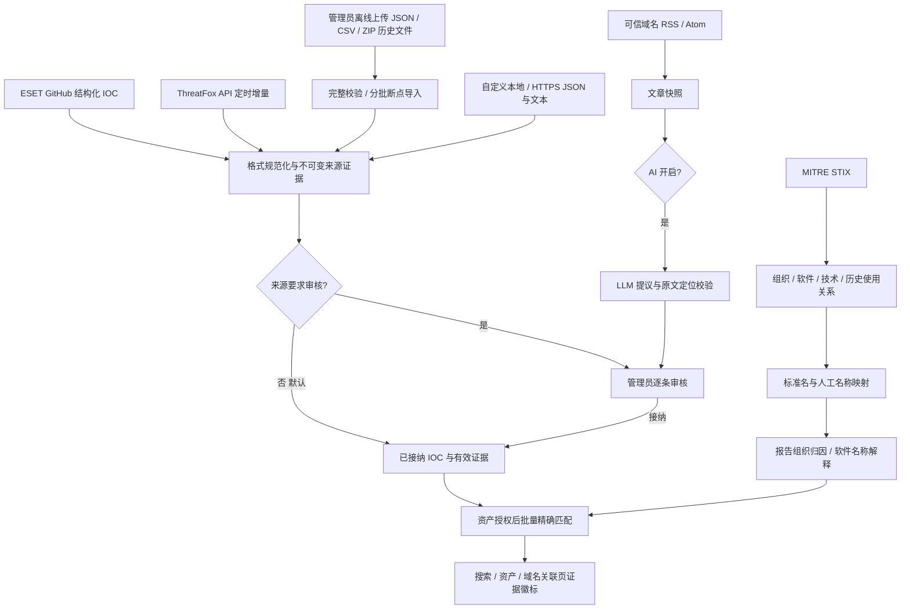

# 威胁情报、可信 IOC 与 AI 审核

[功能概览](FEATURES.md) · [部署](DEPLOYMENT.md) · [搜索](SEARCH_SYNTAX.md)

## 行为约定

可信来源的结构化 IOC 默认直接接纳，不使用置信度阈值、两个来源或 AI 开关作为门槛。
管理员可以在“设置 → 威胁情报 → 来源”打开某个来源的“结构化 IOC 需要人工审核”。
类型与格式校验仍然执行，无法解析的内容不会被伪造为有效 IOC。

RSS 文章由 AI 生成的提议始终需要人工审核。Web、API 均没有关闭 AI 审核的选项；数据库
还会检查证据来源、对应记录和内容哈希的审核决定。AI 输出不能指定 origin、审核状态或
信任标志。关闭 AI 只暂停新提取，不影响可信 IOC 同步、已有已审核 IOC 或自动标记。

接纳、恶意判定和组织归因是不同事实。ThreatFox 的 malware、confidence、reporter、tags
均作为来源元数据；软件家族不会自动生成组织归因。MITRE 关联名称可能部分重叠，只有
标准名称、明确有效的 G 编号或人工核实的来源名称映射可用于标准组织展示。

## 实现方案与取舍



PostgreSQL 保存来源策略、同步作业与文件游标、MITRE 实体和关系、名称映射、文章快照、
证据记录及审核历史。`intel_record` 保留提议和版本；只有接纳时才建立 `intel_ioc`。
`intel_published` 仅提供已接纳且未到期证据。数据库约束与触发器执行 AI 发布门槛，
Web 开关只影响处理队列。配置与人工决定使用现有审计日志。

首版使用 PG 的名称/关联名称候选检索，避免为规模较小的 MITRE 目录增加 ES 双写一致性
任务。模糊候选不自动确认身份。IOC 标记也在资产授权后的读取阶段计算，因此审核、撤销、
到期与名称映射调整不需要等待 ES 重建。ES 仍负责原有资产搜索和权限过滤。

不物化 `IOC → software → actor` 派生归因。MITRE 对象详情可查看软件的已报告使用关系，
这些关系不会进入当前 IOC 的 actor 字段、自动标记或审核通过条件。MITRE、ThreatFox 和
ESET 分别承担规范化、IOC 提供和报告分析角色，不作为三个独立归因来源计数。新增厂商
报告时应保存独立报告证据，不能通过重复转载形成交叉验证。

## 默认来源与周期

首次迁移创建以下来源。它们可以编辑、停用和立即同步；周期范围为 60～2,592,000 秒。
数据保存在 PostgreSQL，重启不会覆盖管理员修改。

| 来源 | 默认周期 | 默认接纳方式 |
| --- | ---: | --- |
| MITRE Enterprise STIX 2.1 | 86,400 秒 | 更新组织、软件、技术和关系基准库 |
| ESET malware-ioc GitHub | 3,600 秒 | 结构化 IOC 直接接纳 |
| ThreatFox recent API | 1,800 秒 | 结构化 IOC 直接接纳 |
| ESET WeLiveSecurity RSS | 1,800 秒 | 发现文章；AI 启用后生成待审提议 |
| ThreatFox 离线历史导入 | 手动上传，不定时拉取文件 | 结构化 IOC 直接接纳 |

自定义 JSON、文本/CSV 的本地或 HTTPS 来源默认 1,800 秒。ThreatFox 导出类型仅支持
离线上传或本地手动导入，不允许配置 HTTPS 导出地址，不参与周期文件抓取。
停用停止后续同步，不删除历史证据。修改免审策略后，新/重读的结构化记录按新策略处理；
已有批准记录不会因打开审核开关而被自动撤销。关闭结构化审核后，再次同步可接纳此前
等待中的结构化记录；AI 提议不会被这一操作接纳。人工拒绝、撤销的同版本记录不会因
普通重试重新生效。

## 本地文件与远程来源

本地根目录由服务端环境变量 `NM_INTEL_LOCAL_ROOT` 指定，默认为
`/var/lib/network-mapping/intel`。Web 填写根目录内的相对文件路径，例如
`eset/feed.json`。路径穿越、目录和指向根目录外部的符号链接均被拒绝。服务进程只读取
文件，不修改来源文件。容器部署时将文件目录只读挂载到配置的根目录即可。

远程来源使用 HTTPS、443 端口和完整域名白名单。来源 URL、RSS 文章地址与 GitHub
文件获取均执行边界检查；不跟随重定向，不访问私网、环回、链路本地或云元数据地址。
使用系统 HTTPS 代理的部署还应在代理侧执行公共目的地址限制，因为代理可能自行解析
DNS。保持 TLS 校验和系统 CA 信任；报告内的 IOC 不会被主动访问，也不会创建扫描任务。

客户端遵循 reqwest 的 `HTTPS_PROXY` / `ALL_PROXY` 和 `NO_PROXY` 规则及大小写变量。
HTTP CONNECT、socks5h 由代理解析目标域名，不再先强制本机解析。直连（含 NO_PROXY）
在连接时解析并检查全部地址，再直接使用检查后的地址连接；socks5 本机解析仍受检查。
代理自身可位于内部网络，但必须在代理侧禁止访问私网和元数据目标，来源域名白名单、
HTTPS、禁止重定向和证书校验仍然执行。

同步提示 `intel_dns_failed` 时，检查服务进程/容器的 DNS 与 NO_PROXY 是否误将目标旁路；
`intel_proxy_dns_failed` 表示代理主机自身无法解析。浏览器能打开网站不证明服务端可访问。
只在实际部署环境配置代理与允许域名，不会自动改用另一条网络路径。

IPv4 抓取按精确特殊用途前缀拒绝文档示例、基准测试、共享地址、退役 6to4 中继、私网和
保留地址，并对 IPv4 映射 IPv6 执行同一判断；例如拒绝 `192.0.0.0/24`，不会扩大到整个
`192.0.0.0/16`。这只限制抓取地址，IOC 自身仍可保存这些网段作为离线证据。
IPv6 抓取仅允许普通全局单播，额外拒绝 `2001::/23`、`2001:db8::/32`、`2002::/16`
及 `3fff::/20`；前缀外相邻地址按原规则判断。IPv6 URL 字面地址先处理方括号，再执行
同一目的地址检查，不能绕过私网、环回及特殊用途地址限制。

凭据支持 Web 写入数据库加密保存，也支持服务端环境变量引用。每个来源与 AI 设置分别
保存 `credential_ciphertext BYTEA`，复用通知渠道的 AES-256-GCM 封装和现有
`server.encrypt_key`（Base64 编码的 32 字节主密钥），不新增另一套加密密钥或算法。
主密钥不写入情报表；备份、恢复及多实例部署必须保持原主密钥一致。

数据库凭据优先；未保存数据库凭据时读取环境变量。`credential` 为只写字段，留空或省略
保留已有值；`clear_credential=true` 显式清除，清除后可使用环境变量备用来源。替换和清除
不能同时提交。保存与轮换受来源/设置 revision 检查保护，AI worker 不会用旧接口配置读取
新版本密钥。解密失败返回 `intel_credential_crypto_failed`，不自动回退到环境变量。

来源列表与 AI 设置只返回 `credential_configured`、`database_credential_configured` 及
`credential_source`（database/environment/none）；不返回明文或密文。凭据不会进入设置
JSON、同步摘要、文章/模型输入或审计元数据。切换本地或离线上传会清除该来源的数据库凭据。

环境变量名称须以 `NM_INTEL_` 开头。例如：

```text
NM_INTEL_LOCAL_ROOT=/var/lib/network-mapping/intel
NM_INTEL_CACHE_ROOT=/var/lib/network-mapping/intel-cache
NM_INTEL_THREATFOX_AUTH_KEY=<由部署环境注入>
NM_INTEL_AI_API_KEY=<由部署环境注入>
```

ThreatFox API 使用 `Auth-Key`；其他结构化 HTTPS 来源的凭据用作 Authorization 请求头。
需 Bearer 的来源应提供完整 `Bearer …` 值。AI 填写原始 API Key，由客户端添加 Bearer。
这些约定对数据库与环境变量两种凭据来源相同。
离线导入不需要配置上游凭据。文件下载由管理员在平台外完成；不将包含访问凭据的导出
地址填入来源配置、文档或 Git。持续更新仍由独立 API 来源完成。

## 数据格式

### JSON

支持顶层数组，或 `{"iocs":[...]}`。以下为可导入的示例数据，不会触发目标访问：

```json
{
  "iocs": [
    {
      "type": "ip_port",
      "value": "192.0.2.20:443",
      "verdict": "malicious",
      "external_id": "report-2026-endpoint-1",
      "malware": "报告中的软件名称",
      "confidence": 20,
      "reference": "https://research.example/report",
      "evidence": "来源明确将该端点列为攻击基础设施。"
    },
    {
      "type": "domain",
      "value": "suspicious.example",
      "verdict": "suspicious"
    }
  ]
}
```

支持 `ip`、`ip_port`（兼容 `ip:port`）、`domain`、`url`、`md5`、`sha1`、`sha256`、`asn`。
ASN 接受 `AS64496`、`64496`、`AS 64496` 及大小写变体，统一为 `AS64496`。编号须在
1～4294967294 内；不接受 AS 路径、ASDOT 或网段。纯数字的无类型文本不猜测成 ASN，
逐行文本请使用带 AS 前缀的完整值。
可选字段包括 `actor_name`、`actor_id`、`techniques`、`victim_industries`、
`victim_countries`、`first_seen`、`last_seen`、`valid_until`。verdict 默认为 malicious，
也支持 suspicious。未知字段报格式错误，不能用于注入审核状态。

### 攻击行为、指标角色与资源登记方

`attack_types` 与 MITRE `techniques` 分开保存。行为分类包括：

| 分类值 | 含义 |
| --- | --- |
| bgp_hijacking / route_leak | BGP 路由劫持 / 路由泄漏 |
| dns_hijacking / dns_response_tampering | DNS 劫持 / DNS 应答篡改 |
| malicious_redirection / phishing | 恶意重定向 / 钓鱼 |
| malware_delivery / command_and_control | 恶意软件投递 / 命令与控制 |
| credential_theft / data_exfiltration | 凭据窃取 / 数据外传 |
| denial_of_service / reconnaissance | 拒绝服务 / 侦察 |

可选 `role` 包括 route_hijacker、malicious_dns、redirect_destination、c2、payload_host、
phishing_host；不明确时留空。`resource_owner` 保存原文明确的资源登记方名称，不作为
攻击组织、MITRE 映射候选或逐 IOC 归因依据。JSON 的 attack_types 使用数组，CSV 用 `|`
分隔。未知分类/角色报 `intel_invalid_classification`。Web 可按 IOC 类型和攻击行为筛选。

```json
{"iocs":[{"type":"asn","value":"AS64496","verdict":"malicious","attack_types":["bgp_hijacking","dns_response_tampering"],"role":"route_hijacker","resource_owner":"Example registered holder","reference":"https://research.example/report","evidence":"报告明确将该自治域列为实施路由劫持及 DNS 应答篡改的基础设施。"}]}
```

无组织名称或软件家族不妨碍接纳有效情报。AI 必须从原文提取 ASN、行为和角色，并附可
定位证据，不能从 IP 推断 ASN、把所有 IP 指定为 DNS 服务或把登记方当攻击者。
MITRE 技术仍只提取原文明示的 ATT&CK 编号，不根据行为分类自动猜测映射。

IOC 保留原始证据中的角色：受害行业和地区是报告上下文，不会被标记成攻击基础设施。
结构化组织归因需要有效 MITRE 组织和明确引用/证据；单纯 malware 或路径中的组织名不
能产生归因。AI 的全部字段仍须人工核对。

### 文本、CSV、Markdown 与 ZIP

文本支持每行一个完整 IOC、空行和 `#` 注释，不从任意正文中用正则挖取 IP。
CSV 使用首行字段名，例如 `type,value,malware,confidence,reference`。
ESET Markdown 仅解析明确的哈希、域名、IP、URL 表格列，不把 Filename 列当成域名。
YARA、Snort 和不支持的 JSON 结构不导入为 IOC，GitHub 作业摘要记录不支持的文件数。

普通周期来源读取上限 96 MiB、单次最多 50,000 条；单文件 ZIP 只读取数据，不按条目路径
解压。大规模历史数据应使用下述离线导入入口，其流式处理不受 50,000 条近期馈送限制。

### 离线历史导入

1. 管理员在 ThreatFox 官方平台下载完整或近期导出文件，保存到本地；系统不定时下载导出。
2. 在 Web“来源”选择预置的“ThreatFox 离线历史导入”，点击“上传离线文件”。支持原生
   JSON、CSV 和只含一个 JSON/CSV 的 ZIP；按内容识别，不信任上传文件名。也支持官方
   URL、域名、IP:端口、MD5、SHA256 子集。通用 JSON/CSV 可新建离线上传来源。
3. 上传后先完整读取、校验并写入私有规范化缓存，然后每批最多 1,000 条入库。ThreatFox
   原生记录中无法规范化的 IOC 单独隔离；文档结构损坏、超限或缓存错误仍拒绝整个文件，
   不提前发布有效前缀。通用 JSON/CSV 保持整文件严格校验。来源审核策略照常执行，
   上传不会改变固定 AI 审核规则。
4. 来源列表显示校验阶段、有效总量与已处理数量，作业页显示错误或分批继续状态。
   “已隔离”可展开前 100 条异常的来源 ID、原值及原因；异常记录不生成标记，也不进入
   AI 审核队列。批次完成后立即排队继续，不再固定等待 5 秒；重启后从数据库中的字节
   偏移和处理数量恢复。重复执行按来源、记录 ID 和
   内容哈希去重。失败可“继续导入”；原始文件有误或缓存丢失时重新上传。

上传原文件上限 512 MiB，解压内容和规范化缓存分别上限 2 GiB，每条数据上限 1 MiB，
最多 1,000 万条。拒绝多文件 ZIP、嵌套 ZIP 和畸形 JSON/CSV，不向文件名指定的位置写入。
超过上限应在本地拆成多个有效数据文件，再逐个上传。同一来源同一时刻只运行一个导入
作业；处理期间不能覆盖文件。修改来源版本会取消旧任务，需要以新版本重新上传。

服务端缓存目录由 `NM_INTEL_CACHE_ROOT` 指定，默认 `/var/lib/network-mapping/intel-cache`，
必须可写并持久化；目录只授予服务账户访问权限。临时文件使用私有权限与随机 ID。
没有异常记录时校验完成清理原文件；有隔离记录时保留原文件直到重新上传替换，便于离线
核对全部异常。导入完成清理规范化文件；失败缓存保留供重试，重新上传会替换旧缓存。
多实例必须使用同一持久化缓存目录及同一主密钥。缓存丢失不删除已提交证据，重新上传
原文件可安全去重。反向代理的请求体限制和上传超时应满足所需文件大小。

上传前先发送不含文件的 `POST /api/intel/sources/{id}/import/check?expected_revision=N`，
检查管理员权限、来源版本、启用状态、活动作业，以及缓存文件实际创建、写入和落盘能力。
检查请求最多等待 15 秒，失败不会发送文件，弹窗保留所选文件并显示错误。检查只创建
随后删除的私有探测文件，不创建快照或同步作业，不占用导入名额；真正上传和最终安装
仍重新校验，避免检查之后的来源变更或并发上传绕过限制。

上传界面在检查阶段显示“正在检查服务端缓存和来源状态”，尚未收到浏览器进度事件时
显示连接中的动画；事件缺少总长度时按所选文件
大小计算百分比。100% 表示发送完成，仍需等待服务器保存并入队。错误在上传弹窗内展示，
保留文件供重试；可取消等待或离开页面中止请求。客户端请求最长 30 分钟；后端连续
60 秒未收到数据会终止接收。已有排队/运行作业时，在接收文件前返回 `intel_import_busy`，
最终安装仍原子复查，避免并发覆盖。

若一直没有进度，检查浏览器请求是否等待连接，是否收到代理的 413/502/504，缓存目录
是否可写且磁盘充足。部署示例普通路由为 64 MiB，大文件需按[部署说明](DEPLOYMENT.md)
单独放宽 import 路由至 512 MiB 并关闭代理请求缓冲。原生服务应预先创建缓存目录并归属
服务账户；Compose 的 server-data 持久卷覆盖该目录，旧卷也需允许 UID 10001 写入。

### 导入缓存权限排查

`intel_import_cache_unavailable` 表示缓存目录创建、解析、私有临时文件创建或探测写入失败。
后端警告日志包含实际路径、失败操作及系统错误，可区分权限不足、只读挂载和空间耗尽。
Web 不显示服务器绝对路径和底层错误。不会自动退回临时目录，以免重启后丢失断点缓存。

原生开发服务默认路径位于 `/var/lib`，普通用户通常不能自行创建。可在**后端仓库目录**
准备一个持久目录，并在**启动后端的同一终端**设置：

```sh
install -d -m 0700 ./intel-cache
export NM_INTEL_CACHE_ROOT="$(pwd)/intel-cache"
# 然后在此终端按原启动命令重新运行后端。
```

该仓库忽略 `intel-cache/`，不要把历史导出缓存提交到 Git。`NM_INTEL_CACHE_ROOT` 是单
下划线变量，由后端直接读取，不是 `VITE_…`、`NM__…` 或 TOML 字段；后端不会自动加载
前端 `.env`。仅在 `pnpm dev` 所在终端设置不会改变已经运行的后端。

systemd 等托管服务须将绝对路径写入服务的 `Environment`/`EnvironmentFile` 并重启后端，
目录及父目录须让实际服务账户可访问。需要保留默认 `/var/lib` 路径时，由管理员预创建
并将其归属服务账户，不要用 `chmod 777`。修改自定义缓存目录前先暂停导入并迁移旧缓存，
保持目录私有；修改路径不会移动已有文件。

官方镜像预创建 UID/GID `10001:10001`、权限 `0700` 的缓存目录，Compose 示例通过
`server-data:/var/lib/network-mapping` 持久化。旧卷和宿主机 bind mount 会覆盖镜像目录，
仍须检查其中缓存目录的属主、访问权限、只读标志和可用空间。修改容器环境后使用
`docker compose … up -d --force-recreate`；仅 `restart` 不更新环境。容器中必须使用已挂载
的绝对路径，不要选择只读根文件系统或仅 64 MiB 的 `/tmp`。

服务器已有文件也可选择 `threatfox_export` + `local`，填写 `NM_INTEL_LOCAL_ROOT` 内的
相对路径后手动“立即同步”；导入完成不会因检查周期再次读取。普通本地 JSON/文本来源
仍可按原有周期读取，因此需要手动历史导入时应选离线类型。

### CLI 快速导入

使用与服务端相同的二进制、配置、PostgreSQL 和持久化缓存目录，可在服务运行期间导入。
CLI 不启动 HTTP、Elasticsearch 或 AI worker，不需要浏览器上传；启动时仍校验配置并
初始化数据库结构。应使用与服务端相同版本，先完成数据库备份和正常升级。

```sh
# 查看支持离线导入的来源 ID、启用状态与审核策略。
network_mapping_server --config /etc/network-mapping/config.toml intel sources

# 默认预置的 ThreatFox 离线来源；替换管理员用户名与本地文件路径。
network_mapping_server --config /etc/network-mapping/config.toml intel import \
  --source 01800000-0000-7000-8000-000000000005 \
  --admin admin --file /data/full.csv.zip --fast

# 中断或失败后，从已提交批次继续；不重新提供文件。
network_mapping_server --config /etc/network-mapping/config.toml intel import \
  --source 01800000-0000-7000-8000-000000000005 \
  --admin admin --resume --fast

# 自定义每批 2,000 条，本次最多提交 10 批；达到上限后暂停并保留断点。
network_mapping_server --config /etc/network-mapping/config.toml intel import \
  --source 01800000-0000-7000-8000-000000000005 \
  --admin admin --resume --batch-size 2000 --max-batches 10
```

环境配置部署将 `--config …` 换为 `--config-source env`。`--admin` 必须是现有有效管理员，
操作写入 CLI 审计；执行者须具备读取配置、本地文件和访问数据库的操作系统权限。
`--source` 须为启用的 upload 来源（json、lines 或 threatfox_export）；不会创建或改写来源
审核策略。CLI 明确指定的本地文件不要求位于 NM_INTEL_LOCAL_ROOT 内，仍复制为私有
缓存快照，并执行与 Web 相同的 512 MiB、格式、完整文档、异常隔离及解压上限检查。

普通 CLI 默认每批 1,000 条，`--fast` 默认 5,000 条。`--batch-size N` 可设置 1～50,000，
覆盖 --fast 默认值；均连续执行，不执行批次间固定等待。
每批还受约 8 MiB 规范化数据预算限制，遇大记录会提前结束批次。终端显示复制、校验、
入库阶段、数量、速度与耗时，最终输出摘要；Web 来源和作业页也能看到相同快照进度。
`--max-batches N` 只计算已提交的数据批次，完整校验阶段不计数；达到上限且仍有数据时
将快照持久标为暂停，后台 worker 不会自行继续。再次使用 --resume，或在 Web 点击
“继续导入”恢复。未指定时连续处理至完成；每次恢复重新计算本次批次数上限。

新写入采用集合 SQL：批量组织解析、IOC 去重和版本写入；数据与断点在同一事务提交。
保留内容哈希、人工拒绝/撤销、同源版本顺序、原观察时间和过期规则。Web/API/GitHub
结构化同步也复用批量写入；AI 仍走固定人工审核流程。快速模式不关闭约束、触发器、
WAL 或同步提交，也不把待审来源自动改为免审。

同一来源只允许一个有效作业租约。CLI 不抢占正在处理的 Web/CLI 作业；使用 Ctrl+C
时结束本次 CLI 执行，未提交批次回滚，已提交批次保留；未暂停的快照仍可能由后台
worker 继续处理。需要持久暂停时使用 --max-batches。进程被强制终止时须等待三分钟
租约过期，再用 --resume 接管；不要删除缓存或直接改数据库状态。文档损坏时须修正并
重新提供 --file，缓存丢失时也须重新上传。无法重试的字段错误会保留具体错误码。

### ThreatFox

默认 API 调用 `get_iocs`，请求最近 7 天。该接口按 first_seen 筛选，首次导入及超过
7 天的停机补采使用离线历史导入。离线 JSON 支持 API data 数组、通用 iocs 数组与官方
按 ID 分组的对象；CSV 保留官方带注释的表头、引号与逗号。完整导出的获取方式以当前
认证门户为准，Web 只上传本地文件，持续更新不改为拉取导出文件。
离线 CSV 接受 UTF-8（含 BOM）、CRLF、逗号后的字段空格、双引号转义、带逗号/换行的
引号字段，以及带 `#` 的表头和说明行；说明文字中的引号不参与 CSV 结构解析。表头须包含
`type`/`ioc_type` 和 `value`/`ioc`/`ioc_value`，数据行字段数须匹配。ThreatFox 的空参考值
`None`/`null`/`N/A` 按缺省处理。缺列、多列、未闭合引号或错误编码仍拒绝完整文件。
官方 `md5_hash`、`sha1_hash`、`sha256_hash` 类型统一规范化为库内的 md5、sha1、sha256，
API、离线导入及通用文本来源中的原生 CSV 共用字段转换与 IOC 规范化。

#### 官方字段与值类型

以下结合 [ThreatFox API 文档](https://threatfox.abuse.ch/api/)与实际导出文件核对。
`ioc_type` 是指标格式，`threat_type` 是用途分类；不能把两者混用。官方通过
`{"query":"types"}` 提供当前类型列表，文档示例不代表永久封闭枚举。本次完整导出中
出现以下六种 IOC 类型：`domain`、`url`、`ip:port`、`md5_hash`、`sha1_hash`、`sha256_hash`。

| 字段 | API / JSON 与 CSV 差异 | 处理方式 |
| --- | --- | --- |
| ID | API `id` 为字符串；JSON 导出按 ID 分组；CSV 为 `ioc_id` | 保存来源 ID，不将其当作 IOC 值 |
| 指标值 | API `ioc`，导出 `ioc_value` | 按 ioc_type 规范化并保留精确范围 |
| `threat_type` | 字符串；样本含 botnet_cc、payload、payload_delivery、cc_skimming | 原样保存上下文，不用于推断组织 |
| `malware` | API/JSON 为机器名称；CSV 为 `fk_malware` | 保存机器名称及 malware_printable 展示名称 |
| `malware_alias` | 字符串或 null | 仅作为软件名称备用值 |
| `confidence_level` | JSON 整数 0～100；CSV 为数字文本 | 保留数值，0 也不阻止可信来源接纳 |
| 首次/最后观察 | API first_seen/last_seen；导出带 `_utc`；最后观察可为 null | UTC 时间用于证据与本地到期计算 |
| `reference` | 字符串或 null；CSV 可能为 None/null/N/A | 空值不生成链接；非空引用仍校验格式 |
| `tags` | API 示例为字符串数组或 null；本次 JSON 导出为逗号分隔字符串或 null，CSV 为文本 | 保留来源结构，不按数组强制反序列化 |
| `is_compromised` | JSON 布尔；CSV True/False 或 1/0 | 保留布尔元数据 |
| `reporter` / `anonymous` | 字符串 / 数字标志 | reporter 保留为来源上下文；anonymous 不作为信任门槛 |

类型与字段形态会随官方接口变化，新增不支持的原生 IOC 类型计入隔离报告，不能猜测成
其他类型。上述导出观测值不代表官方对未来所有数据的保证。

URL IOC 接受 HTTP、HTTPS、FTP、FTPS、SMB、TFTP、TCP、WS、WSS、带 userinfo 的 URL，
以及无协议的主机/路径，
支持 `[.]`、`[:]`、`[://]` 和不区分大小写的 hxxp/hxxps 还原。无协议 URL 保留无协议形式，
不会猜测 HTTP/HTTPS，也不扩大为域名或 IP 标记。URL IOC 只存储和精确匹配，不作为抓取地址；
远程来源和参考链接继续执行各自的协议、凭据、白名单及地址校验。域名 IOC 支持 IDN
转 ASCII 以及下划线 DNS 名称；IP:端口可保存 0～65535，端口 0 仍是精确 IOC，不扩大成
整 IP，也不允许据此创建端口 0 扫描。畸形 JSON 与 IOC 字段错误分别记录具体错误码，
不再把字段校验失败统一报告为 `intel_invalid_ioc_document`。
ThreatFox API 和原生离线文件单独隔离无法识别的 IOC/引用等字段错误，其余有效记录按
来源策略接纳。汇总 `validation.rejected` 为异常总数，`rejection_samples` 最多保存 100 条
记录位置、来源 ID、类型、原值和错误码；不会把异常值变成有效 IOC。语法、资源限额、
磁盘、凭据和网络错误仍终止处理。
ESET GitHub 仓库按文件校验：个别 JSON 本身语法错误时，不发布该文件的有效前缀，记录
`unsupported_files`、`unsupported_paths` 并继续其他文件；后端警告日志说明畸形 JSON。
上游修正文件后 blob 哈希变化会重新解析。没有受支持 IOC 类别的报告也按无可导入内容
记录，不放宽受害目标/背景属性过滤。原生 MISP 内单个合格类别属性的 IOC 格式错误则计入
同一 validation 报告，其余合格属性继续处理；通用 JSON/MISP 来源仍保持严格校验。

来源置信度不会过滤 IOC。保存 first_seen、last_seen、reporter、reference 和恶意软件
名称。官方 recent 文件包含 first_seen 或 last_seen 在最近 48 小时内的 IOC，这只是离线
文件的内容范围；系统不按它的生成周期抓取文件。滚动窗口缺少记录不表示来源撤回。
官方自 2025-05-01 起会将超过六个月的 IOC 从 API 与导出中移除，因此 full 不等于永久
全历史。系统保留已导入历史与原观察时间，本地默认六个月过期独立执行。

### 自动过期

每个来源的 `expiry_months` 默认 6 个日历月，可在 Web 调整为 0～120。到期基准依次为
可解析的 last_seen、first_seen、首次入库时间；无时区的官方时间按 UTC，未来时间最多
按入库时刻计算。观察时间不可变，同版本反复拉取或导入不会刷新有效期。后续来源明确
提供更新的观察时间时形成新版本。历史全量中超过期限的 IOC 仍保存证据，但立即归入过期。

有效期取本地来源期限与显式 `valid_until` 的较早者。0 表示不加本地期限，不能绕过来源
明确给出的到期时间。调整来源期限在后续读取立即生效；不删除历史或更改审核决定。
过期证据显示灰色“已过期”，不贡献当前恶意/可疑标记；同一 IOC 仍有其他有效来源证据
时保留其当前风险。此策略适用于自动情报，人工标签不受影响，也不对 MITRE 名称库计时。

官方说明：[API](https://threatfox.abuse.ch/api/)、[导出](https://threatfox.abuse.ch/export/)。

### ESET GitHub

默认来源读取 `eset/malware-ioc` 的递归 Git 树，分批获取变化文件，每批最多 20 个，
尚有文件时 5 秒后继续。文件内容的 Git blob OID 与清单核对后才解析，避免上游更新
期间混合快照。文件哈希游标保存在数据库，重复同步不会重复创建同版本证据。
仓库目录名不用于自动组织归因，README、YARA、Snort 规则不作为 IOC 文本导入。
文件后缀按大小写无关分派 JSON/Markdown/文本。文件游标保存解析器版本；旧版误跳过的
大写或混合大小写 JSON/MD 即使 blob 未变化也会重读一次，成功后恢复正常哈希跳过。
解析器版本 3 还会重读此前版本的文件一次，修复协议、IDN、BOM 和 CSV 兼容问题；不会
通过改写观察时间为旧 IOC 续期。

原生 MISP JSON 支持 `Event` 与 `response` 封装，读取事件及对象中的 Attribute，仅导入
Network activity、Artifacts dropped、Payload delivery 类别的目标 IP、域名、URL 和哈希。
不导入受害目标、来源链接、已删除属性或邮件上下文。旧 ESET 导出的 to_ids=false 不作为
可信 IOC 的置信度门槛；事件标题和事件级 Galaxy 只保留上下文，不扩散为逐 IOC 归因。
本地或远程 JSON 来源也可读取相同 MISP 格式。AsciiDoc、YARA 等未适配格式不作为通用
正文挖取；需要其报告上下文时，由独立 RSS 提取生成固定待审提议。

## AI 配置与审核

### 手动文章与微信公众号

新建 `kind=article`、`transport=manual` 来源，location 与凭据留空，配置允许的完整
文章域名。在 Web“文章”页展开“提交文章链接 / 正文快照”，选择来源并填写标题和原文
HTTPS 地址。正文可留空由后台抓取，或粘贴 40～100,000 UTF-8 字节的纯文本。
手动来源不执行周期抓取，“立即同步”不适用于此类型。AI 关闭时仍可保存文章，队列
等待 AI 开启；所有提议固定人工审核，来源 require_review 不能绕过这一门槛。

微信远程抓取需要在来源填写具体账号的 `publisher_id`（文章完整链接中的 `__biz`），
不能填公众号昵称。抓取后核对页面脚本中的账号标识并读取 `#js_content`，保留正文和
表格文本，排除脚本、导航及隐藏文本。不执行页面脚本、不绕过验证页；账号不一致、
正文缺失或网络受限时失败并可重试。`mp.weixin.qq.com` 域名白名单本身不代表账号可信。
普通文章使用通用静态正文提取：优先识别 `articleBody`、WordPress/Ghost 等常见正文
容器与 `<article>`，再读取明确标为 Article/NewsArticle/BlogPosting 等类型的 JSON-LD
`articleBody`；随后尝试 `<main>` 与主体角色，最后按段落数量、正文占比和链接占比选择
无标准标记的内容块。排除导航、页头页尾、侧栏、推荐文章、脚本和隐藏文本；内联标签
不拆散 IOC，保留表格内容。WeLiveSecurity 的 `.article-body` 仅为优先适配，失败后同样
走通用流程；RSS 来源和 AI 分析不限定厂商。RSS 发现的微信链接仍执行账号核对。

RSS 2.0 与 Atom 使用同一发现队列，Atom 链接支持自闭合/成对标签和 XML 实体解码。
来源需要显式允许 RSS 主机和文章主机；不会自动访问白名单外的文章域名。通用提取
不保证所有页面成功：不执行 JavaScript、不绕过验证/登录页、不读取整页导航或把摘要
当作正文；取不到正文时保留可重试失败，可由管理员提交正文快照。

微信链接只保留文章身份参数 __biz、mid、idx、sn；去掉 poc_token 等访问/跟踪参数，
规范化地址用于保存、抓取、引用和 AI 输入。手动正文标记为
`intake.publisher_verification=administrator_supplied`，不宣称已从官方网络页面核验；
微信远程账号匹配记录为 page_account_match。审核页可查看 intake 元数据和正文。
以上方式均保存快照哈希与来源 revision，重复提交同一内容幂等，新正文保留为独立快照；
重试复用已保存快照。修改或停用来源会取消旧版本排队/运行任务。

```json
{"source_id":"<来源 UUID>","expected_revision":1,"title":"路由及 DNS 异常报告","url":"https://research.example/report","body":"<可选的完整纯文本正文>"}
```

该请求提交到 `POST /api/intel/articles`，响应为文章 id、queued 与固定
ai_review_required=true。管理员权限、现有 CSRF 与审计规则保持执行。

### 提取与审核

管理页面填写兼容 Chat Completions 的完整 HTTPS 接口地址、模型名称，并保存数据库凭据
或填写凭据环境变量，
然后开启 AI。当前使用 `messages` 请求及 `choices[0].message.content` 响应，仅适配 Chat
Completions；不支持使用 `input` / `output` 的 Responses API。接口需要支持 JSON 对象输出。
响应格式不匹配时错误详情记录预期字段及是否发现 Responses 的 `output` 字段，不保存响应正文。
首版提取只有一个独立 worker，单次正文
最多 100,000 字节、输出最多 200 条 IOC，模型回复预算 8,000 tokens；文章和模型回复
HTTP 读取上限各为 2 MiB，RSS/Atom 解析上限 4 MiB。管理页的“AI 请求超时（秒）”
默认 180 秒，可设为 1～1800 的整数，对应设置 API 的 `ai_timeout_seconds`；旧配置缺省时
自动使用 180 秒。该时限覆盖 AI 请求到响应体读取完成；连接阶段仍限制为 10 秒。
文章总处理时限为 AI 请求超时加 120 秒，任务租约再多 30 秒，避免长请求提前失去租约。
普通原文请求为 30 秒，ThreatFox 增量下载为 120 秒。来源同步 worker 独立运行，不等待 AI 成功。

RSS/Atom 只发现白名单域名文章；去除脚本、导航及隐藏文本后保存文章快照。重试使用
已保存快照，避免审批引用变化的正文。候选组织来自有效 MITRE 基准库，模型不能创建
新组织。提议必须附带在正文中可定位、包含该 IOC 的原文证据。
仅证据不符的条目会被单独剔除，其余有效条目生成待审提议；全部证据不符时仍标为失败。
未知字段、非法指标、响应格式和数量超限等错误仍拒绝整批结果。

AI 返回空 IOC 数组属于正常完成，文章保存为 `succeeded`，显示“提取已完成，未生成提议”。
文章列表接口返回 `record_count` 与 `pending_count`，页面按真实待审数显示状态；历史
`proposed` 记录也使用这两个计数，不再把空结果显示成已生成提议。审核完毕的文章显示
无待审提议。`extraction_metadata.result` 保存本次有效解析数 `parsed`、实际新增数
`inserted` 及证据拒绝摘要 `validation`；重复写入不会计入新增数。已完成文章仍可重新提取。

### 文章失败诊断与日志

在“文章”列表的失败记录下展开“错误详情”，可查看文章 ID、失败阶段、发生时间、任务标识
和尝试次数。HTTP 失败还记录目标主机/端口、方法、请求阶段、状态码、耗时、读取大小、超时/
连接标志及可用的系统错误类别/编号。`cause_hint` 是 TLS 证书、TLS 握手或代理隧道的分类提示，
不包含原始异常文本；`proxy_env_keys` 只列出已设置的代理变量名，不代表该请求实际使用了代理。
正文解析失败记录选择器、页面大小，以及 `selector_not_found`、`text_too_short`、
`no_valid_article_candidate` 或 `challenge_page` 原因。
AI 证据失败记录条目序号 `record`、拒绝数 `rejected` 和固定原因分类；不记录模型返回文本。
HTTP 诊断记录 `timeout_seconds`，文章失败还记录 `processing_timeout_seconds`。

处理阶段包括 `article_fetch`（抓取原文）、`article_parse`（解析正文）、`ai_settings`（读取模型配置/
凭据）、`ai_request`（请求 AI）、`ai_response`（解析响应）、`ai_validate`（校验证据）和
`indicator_store`（保存提议）。AI 请求使用独立的 `intel_ai_*` 错误代码；已保存正文的手动文章
和重试文章直接复用快照，AI 连接失败不再显示为文章来源连接失败。HTTP 401/403 应检查凭据，
404 应检查完整接口地址，429 表示限流，5xx 应检查提供方服务；实际状态码在详情中查看。

最近一次诊断保存在 `intel_article.extraction_metadata.last_error`，通过现有管理员文章接口返回。
来源同步的失败诊断保存在作业 `summary.last_error`。更新结果仍校验任务租约和 claim token，
防止过期 worker 覆盖新任务；每次失败替换最近一次诊断，成功后清除文章的最近失败详情。
历史失败没有可追溯补写的网络信息，需在修复配置后重试，才能生成新诊断。

服务端沿用 `[log].directory`、`[log].file_name` 和滚动配置写入 JSON 日志，无需开启 DEBUG：

- `IntelArticleExtractionFailed`：文章 ID、来源 ID、claim token、尝试次数、错误代码和诊断。
- `IntelArticleExtractionSucceeded`：文章任务完成、有效解析数 `indicators`、实际新增数 `inserted` 和证据拒绝数 `rejected`（均可能为 0）。
- `IntelHttpRequestFailed`：网络请求的脱敏诊断；文章请求还带 `intel_article` span 的关联 ID。
- `IntelSourceSyncFailed`：来源同步作业 ID、来源 ID 及失败诊断。
- `IntelAiWorkerFailed` / `IntelSourceWorkerFailed`：队列读取或结果持久化等 worker 级故障。

复制页面的文章 ID，在实际日志目录检索该 ID 即可串联失败与重试；路径以启动日志中的
`log_directory` / `log_file` 为准。原始正文、AI 请求/响应内容、认证头、代理地址和完整请求 URL
均不进入这些诊断，避免 URL 路径/查询参数携带的密钥泄露。数据库错误仅记录 SQLSTATE 与连接
关闭标志，不记录 SQL 参数或原始数据库异常文本。

文章绑定发现时的来源 revision。来源编辑、停用或更改格式后，旧版本排队/运行中的
文章取消，不允许通过重试接口改挂到新版本。重新同步会按新 revision 建立独立文章与
快照；相同来源版本的重复发现仍幂等。迁移会调整文章唯一约束，不覆盖旧快照与审核记录。
保存快照和写入提议时均再次检查任务租约、来源 ID 与 revision。
每条 AI 提议的入库事务还会锁定并核对本次请求使用的 AI 设置 revision；模型、接口或
凭据配置发生变化后，旧响应停止继续写入，文章可按新配置重试。已提交提议保留原提取
元数据，仍须人工审核。

在“审核”页逐条检查 IOC、原文证据、组织、软件、攻击技术和受害目标信息。每条记录
可单独接纳或拒绝；同一提议的所有所列事实随该条决定处理。说明字段必填，审核请求
绑定 content_hash。并发重复审核只会有一次成功，陈旧版本返回 409。

Web 接纳 AI 提议前要求成功加载非空文章快照。加载失败或正文缺失时显示错误与重试入口，
不能提交接纳，也不会显示为结构化来源；加载尚未结束、失败或正文缺失均不阻止拒绝
或撤销证据。说明和记录版本校验仍须满足，重试保留审核说明。

在 IOC 库可撤销一条已接纳证据。其他来源对同一 IOC 的有效证据不受影响。
名称映射区分组织与软件，只能指向相应类型的有效 MITRE G/S 编号；补别名不会创建
实体。删除映射立即取消依赖它的标准名称展示，原始来源名称与审核证据仍保留。MITRE 的 Associated Groups
仅用于候选检索，不自动视为等价别名。

AI 配置修改和审核均写入现有审计系统。提议保存文章版本、来源版本、内容哈希、模型、
提示词版本和候选集合哈希。模型输出、文章快照均以文本展示，不作为 HTML 执行。

## 自动标记与范围

已授权的搜索结果和资产端点在返回时批量查询有效情报，因此可信来源的新记录或人工
审核/撤销在后续读取立即反映，不依赖重扫或另一次 ES 富化任务。

| 类型 | 标记范围 |
| --- | --- |
| IP | 同一规范化 IP |
| IP:端口 | 同一 IP 与端口；不升级成整 IP 标记 |
| Domain | 精确域名查询；不扩大到父域、子域或 DNS 解析 IP |
| URL | 精确 URL 查询；不扩大到域名或 IP |
| 文件哈希 | 可保存和精确查询；当前扫描协议未采集通用文件样本，不能宣称样本命中 |
| ASN | 同一规范化 ASN；资产所属 ASN 的证据作为独立上下文展示 |

域名关联页使用精确 IOC 查询；搜索和资产端点自动匹配 IP、IP:端口。URL 和哈希可在
IOC 库查询或通过 lookup API 精确查询。端点没有实际 URL/文件观察证据时，不生成命中。
TLS SAN、相同证书、ASN、软件家族均不用于扩大 IP 标记。
ASN 的 lookup 返回该 ASN 本身的结论。资产概要和搜索结果在授权过滤后批量匹配已有
ASN 字段，返回独立 `intel.asn_context`（available/risk/matches/expired_matches），不改变
IP/端点自身的 risk 和 matches，不创建派生 IP IOC。Web 显示“所属 ASN：恶意报告 /
可疑报告 / 已过期”。缺少有效 ASN 数据时不猜测，不用当前 ASN 元数据证明历史 AS 路径。
这是报告情报匹配，不代表系统已监测到当前 BGP 路由或 DNS 流量异常。

响应新增独立 `intel` 对象，包含 available、risk、matches、expired_matches；有效证据与
过期历史分别返回，单个 IOC 每组最多 10 条。原有 tags 仍是人工标签，
自动情报不删除、覆盖人工标签，也不占用每 IP 20 条人工标签配额。冲突证据并列解释。
未命中不表示正常；情报存储失败返回 available=false，界面显示暂不可用。

来源和已接纳公共情报是全局知识；资产授权仍先由原有 ES user/global scope 执行。
情报接口不提供其他用户的资产数量。只有管理员可管理来源、设置、文章、映射和审核。

## API

所有接口复用登录、CSRF 和管理员检查。除 entities、lookup 及已批准 records 查询外，
以下接口均限管理员。

| 方法与路径 | 用途 |
| --- | --- |
| `GET/POST /api/intel/sources` | 来源列表、创建 |
| `PUT /api/intel/sources/{id}` | 更新来源，携带 expected_revision |
| `POST /api/intel/sources/{id}/sync` | 幂等入队，复用进行中的同源作业 |
| `POST /api/intel/sources/{id}/import?expected_revision=N` | 管理员上传原始文件体，Content-Type 为 application/octet-stream；仅 upload 来源 |
| `POST /api/intel/sources/{id}/import/check?expected_revision=N` | 管理员上传前检查；无文件体，不排队、不预留来源，返回 `data.ready=true` 后再传文件 |
| `GET/PUT /api/intel/settings` | AI 设置、配置 revision、固定 ai_review_required=true |
| `GET /api/intel/records` | status、q、source_id、offset、type、attack_type；每页 50 条 |
| `POST /api/intel/records/{id}/review` | content_hash、decision、reason；decision 为 approved/rejected/revoked |
| `GET /api/intel/entities` | kind=actor/software/technique、q；最多 100 条 |
| `GET /api/intel/entities/{attack_id}` | MITRE 对象与关系；软件使用关系不代表当前 IOC 归因 |
| `GET /api/intel/lookup?type=domain&value=example.com` | 精确 IOC 查询 |
| `GET /api/intel/jobs` | 最近 100 次作业 |
| `GET/POST /api/intel/articles` | 最近 100 篇文章 / 管理员提交链接或正文快照 |
| `GET /api/intel/articles/{id}` | 审核所需文章快照 |
| `POST /api/intel/articles/{id}/retry` | AI 开启时重试失败或重新提取已完成文章，复用保存快照 |
| `GET/POST /api/intel/mappings` | 未映射名称、已确认映射；写入 source_id/name/attack_id/kind（actor 或 software） |
| `DELETE /api/intel/mappings/{id}?attack_id=Gxxxx` | 按预期目标撤销映射，陈旧目标返回冲突 |

AI 设置请求为 `{"expected_revision":1,"settings":{"ai_enabled":false,...}}`。来源和
设置修改采用乐观版本检查。固定 AI 审核字段不可在请求中修改，未知字段拒绝。

来源 `transport` 支持 local/https/upload/manual，`expiry_months` 默认 6。manual 仅用于
article 来源，须配置 allowed_hosts；publisher_id 可绑定微信账号。upload/manual 的 location 和
凭据字段必须为空。来源响应的 `import_status` 返回 stage、total、processed、validation；
作业 summary 同样包含 validation。无文件时 import_status 为
null。records 的 status=approved 只列当前有效证据，status=expired 列已接纳的过期证据
（管理员）。证据响应 valid_until 为计算后的有效期，expired 表示时间状态。

来源创建/更新请求可附加 `credential` 或 `clear_credential`；AI 更新请求则放在
`settings` 对象内。它们仅用于写入加密字段，不包含在后续配置响应中。例如：

```json
{"expected_revision":2,"settings":{"ai_enabled":false,"ai_endpoint":"https://api.example/chat","ai_model":"model-name","ai_key_env":"","credential":"<本次新密钥>"}}
```

省略 credential 保留数据库密钥；清除时省略 credential 并传 `clear_credential:true`。
凭据最多 8192 字节，拒绝纯空白与控制字符。Web 密码框保存后清空，读取接口不支持取回。

同步作业使用 PostgreSQL 租约和 claim token；网络及 LLM 调用期间不持有 PG 连接。
停用/修改来源及作业租约失效后，旧 worker 不能继续提交新证据。原始扫描 observation、
上传回执和 payload checksum 保持独立，未增加扫描器协议字段。

## 部署、恢复与测试

升级后数据库初始化会执行幂等迁移 `migrate_threat_intel.sql`。部署前备份 PG，并先部署
后端，再部署包含情报页面的 Vue 前端。首次使用先查看来源作业状态，确认 MITRE、
ESET 和 ThreatFox 的网络及凭据配置。外部来源失败不会阻止服务启动或本地来源工作。

允许访问配置中的确切域名：默认包括 api.github.com、raw.githubusercontent.com、
threatfox-api.abuse.ch、www.welivesecurity.com；AI 服务还需要其接口域名。站点迁移时
先核对官方来源，再修改 URL 和白名单，不自动信任重定向后的新域名。

恢复时可暂停来源、关闭 AI，修复文件/网络/凭据后立即同步；文章提取失败后可重试。
需要取消某条有效结论时撤销对应证据，不能靠删除某次作业记录实现。

```sh
cargo fmt --check
cargo test --locked threat_intel --lib
# 下列数据库必须是可丢弃的专用测试库，各测试使用独立 schema。
INTEL_TEST_DATABASE_URL=postgres://user@127.0.0.1/intel_test \
NM_INTEL_LOCAL_ROOT=/tmp/intel-test-fixtures \
NM_INTEL_CACHE_ROOT=/tmp/intel-test-cache \
cargo test --locked threat_intel --lib -- --include-ignored
```

回归覆盖可信低置信度数据免审、AI 关闭时的结构化同步、不可绕过的 AI 审核、版本冲突、
重复接纳、并发审核、撤销、精确端点范围、RSS/Atom/Markdown、ZIP 和本地路径边界。
另覆盖旧文章取消与重新发现、特殊用途 IPv4/IPv6 边界、凭据随机 nonce/认证失败、数据库密文、
空值保留/替换/清除、陈旧版本冲突和 API/审计不泄露凭据。
离线测试覆盖原生 JSON/CSV/ZIP、超过 50,000 条的流式解析、完整校验后发布、跨批续传、
租约恢复、无周期导出抓取、观察时间有效期、过期历史、重复导入不续期和带数据迁移。
另覆盖代理远程 DNS、直连 DNS/私网拒绝、混合大小写 GitHub 游标修复和真实 HTTP 分块
上传（独立处理器 + PG，20 MiB 以上文件，设置小 JSON/Payload 限额验证原始流式入口），
以及无文件体的缓存探测、来源版本/权限/活动作业检查。CSV 回归包含注释引号、字段空格、
BOM/CRLF、多行字段和空参考值；URL 回归包含官方 MISP 的 SMB 与无协议字段，并断言
来源抓取规则不变。可通过 `NM_INTEL_MISP_FIXTURES` 指向本地官方 MISP JSON 样本目录
附加逐文件解析验证。可设置
`NM_INTEL_HTTPS_SMOKE=1` 在代理测试中附加真实 GitHub HTTPS 读取，使用现有代理和 CA，
无需上游凭据；默认测试仅使用本地代理 fixture。
`NM_INTEL_ESET_HTML_FIXTURE=/absolute/path/article.html` 可附加验证本地保存的真实
WeLiveSecurity 页面正文提取；`NM_INTEL_GENERIC_HTML_FIXTURE=/absolute/path/article.html`
可验证任意发布站点的通用提取，不启用站点专用适配。文件仅用于测试，不提交正文到仓库。
若已有官方完整导出 ZIP，可使用生产流式解析器验证两个本地文件（不会下载或发布 IOC）：

```sh
NM_INTEL_JSON_EXPORT_FIXTURE=/absolute/path/full.json.zip \
NM_INTEL_CSV_EXPORT_FIXTURE=/absolute/path/full.csv.zip \
cargo test --locked --lib threatfox_transport_url_iocs -- --nocapture
```

验证覆盖原生 JSON、CSV 与 API 的 TFTP/TCP/WebSocket URL，保留 URL 精确范围并断言来源
抓取仍拒绝这些协议。外部文件测试输出有效记录数、隔离报告和规范化大小，测试缓存自动清理；不将导出
文件、实际 IOC 或带凭据的下载链接提交到仓库。日常运行仍通过 API 更新，导出文件只用于
离线上传/导入。
本次对用户提供的两份完整 ZIP 分别逐条验证：各 114,663 条，114,659 条有效、4 条域名
值异常并隔离。真实 ESET MISP 样本 24 份中 21 份可解析、2 份无合格 IOC 类别、1 份
上游 JSON 损坏；真实 MITRE Enterprise STIX 原子导入 1,905 个实体。可设置
`NM_INTEL_STIX_FIXTURE=/absolute/path/enterprise-attack.json` 在数据库测试中复验基准库。
其他来源回归覆盖文本的 TFTP/TCP/WS(S) 和去活化 URL、Markdown 的 IDN、通用 CSV 的
注释/引号/列数和原生字段、JSON/STIX 的 BOM、RSS 的 BOM/DOCTYPE 拒绝及 AI 原文证据
定位。AI 仅接受能在文章中精确定位的证据，修复去活化 URL 不改变人工审核门槛。
真实 LLM 调用需要实际配置的服务和密钥；解析器 fixture 测试不代表已调用真实模型。
ASN 扩展回归覆盖 ASN 规范化、JSON/CSV/文本输入、原有 payload 哈希兼容、行为筛选、
免审/固定 AI 审核、到期和带历史数据迁移，以及 ASN 上下文不生成 IP 标记。文章回归
覆盖管理员权限、来源 revision、重复提交、快照保留、AI 关闭等待、账号核对、微信参数
清理、表格正文与隐藏脚本过滤。微信抓取使用 HTML fixture；真实微信页面可能要求
验证，需部署环境实测，受限时使用手动正文，不宣称已完成真实 LLM/微信联调。
AI 配置并发回归验证同一响应在配置更新后停止写入，以及提议入库事务提交前持有配置
共享锁；配置变更不会让旧响应按新配置版本入库，固定人工审核保持执行。
批量导入回归与逐条实现对照内容哈希、组织映射、多版本顺序、重复及拒绝/撤销结果；
另覆盖 CLI 参数范围、管理员检查、自定义批次/持久暂停/继续、活动租约拒绝与超时接管、
断点更新失败时整批回滚，以及 1,000 条合成记录的同库吞吐对比。实际 CLI 使用官方 CSV
完整 ZIP 在专用测试库验证：114,659 条有效记录写入、4 条异常隔离，5,000 条/批，先提交
两批暂停后恢复完成；本地调试构建处理合计约 57 秒，不含人为暂停时间。这是本地验证
结果，生产耗时取决于数据库、磁盘及记录大小。
